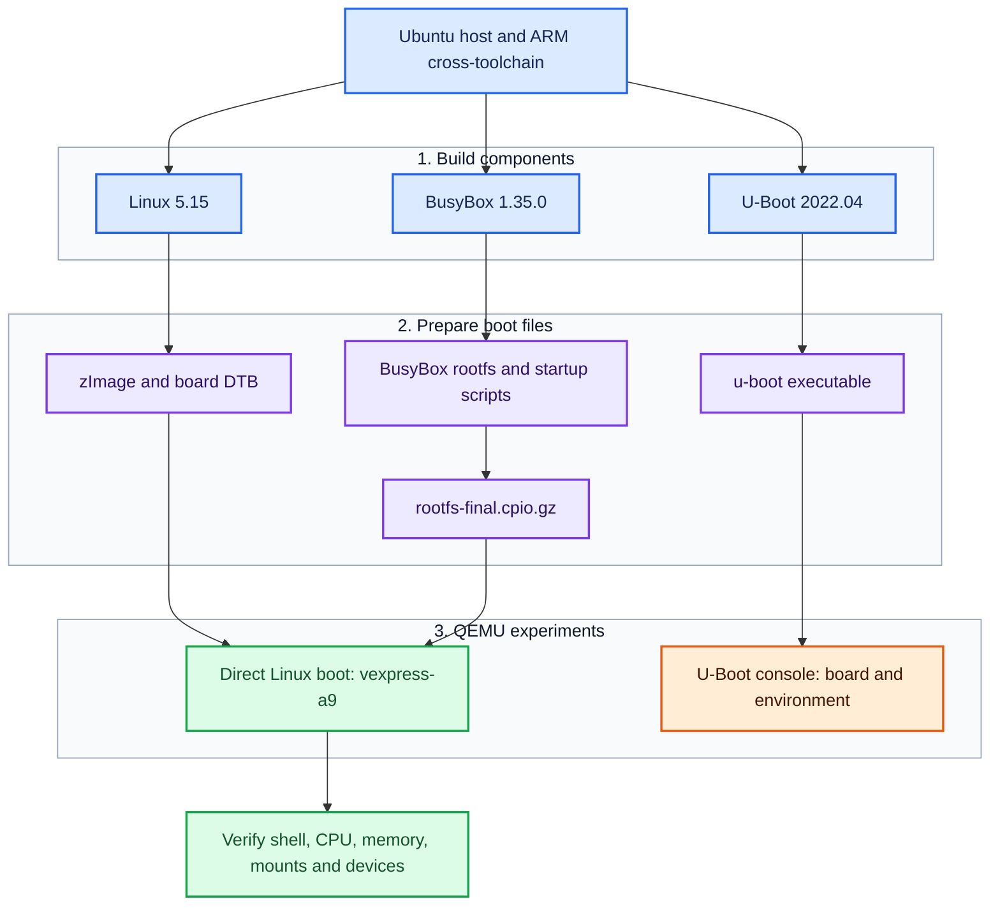
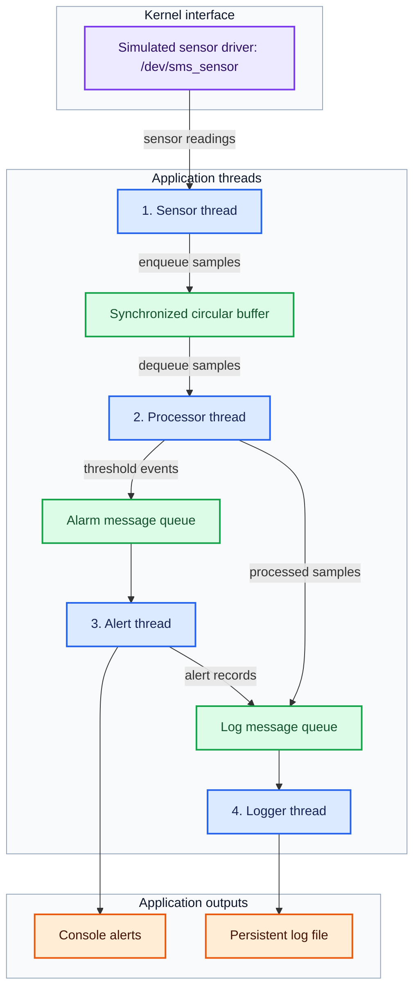

# LOS201 – Embedded Linux Systems

Group coursework repository for **LOS201 – Embedded Linux Systems** at
**FPT University**.

This repository brings together our practical work on ARM Linux system
construction, device drivers, flash filesystems, application debugging,
performance analysis, and a sensor monitoring application.

The coursework is organized so that the lecturer and other readers can find
each contributor's source code, configuration files, technical reports, and
supporting evidence.

**Start here:** [LAB01 Quick Start](lab01/README.md#quick-start) · [LAB02 guide](lab02/README.md) · [Assignment 1 guide](asgn01/Assignment%201/README.md)

## Contents

- [Team Members](#team-members)
- [Technical Platform](#technical-platform)
- [Coursework Overview](#coursework-overview)
- [Repository Organization](#repository-organization)
- [LAB01 – ARM Linux System Build and Boot](#lab01--arm-linux-system-build-and-boot)
- [LAB02 – Device Driver and Filesystem Management](#lab02--device-driver-and-filesystem-management)
- [LAB03 – Debugging and Performance Analysis](#lab03--debugging-and-performance-analysis)
- [Assignment 1 – How to Write a Device Driver](#assignment-1--how-to-write-a-device-driver)
- [Assignment 2 – Sensor Monitoring System](#assignment-2--sensor-monitoring-system)
- [Reports and Evidence](#reports-and-evidence)
- [Team Collaboration](#team-collaboration)

## Team Members

| Full Name | Student ID | Assigned Coursework |
|---|---|---|
| Trần Thiên Phúc | SE203798 | LAB01 and Assignment 2 |
| Nguyễn Huy Hoàng | SE203347 | Assignment 1 |
| Đinh Quang Ngọc | SE201573 | LAB03 |
| Võ Quốc Thịnh | SE200595 | LAB02 |

**Repository owner:** Trần Thiên Phúc.

GitHub accounts will be added when available.
The contributor responsible for each submission is identified in its own
documentation and commit history.

## Technical Platform

The ARM system used for LAB01 and LAB02 provides the foundation for the
later coursework.

| Component | Platform / Version |
|---|---|
| Development host | Ubuntu Linux |
| Target architecture | ARMv7-A |
| Target CPU | Cortex-A9 |
| Emulated board | QEMU `vexpress-a9` |
| Linux kernel | 5.15 |
| Bootloader | U-Boot 2022.04 |
| Minimal userspace | BusyBox 1.35.0 |
| Cross-compilation prefix | `arm-linux-gnueabihf-` |
| Source languages | C and shell scripts |
| Build system | GNU Make / kernel module Makefiles |
| Debugging and analysis tools | GDB, gdbserver, Valgrind, strace, perf, and cyclictest |

Host and ARM target programs use different binaries. Kernel modules must
match the architecture and kernel build of the system where they are loaded.
Exact commands and environment details belong in the documentation for each
coursework item.

## Coursework Overview

The coursework consists of three laboratory exercises and two assignments covering ARM Linux system development, device drivers, flash filesystems, debugging, performance analysis, and a sensor monitoring application. The table below summarizes each coursework item and identifies the team member responsible for its implementation and documentation.

| Coursework | Main Topic | Contributor |
|---|---|---|
| [LAB01](lab01/README.md) | ARM Linux system build and boot | Trần Thiên Phúc |
| [LAB02](lab02/README.md) | Device driver, procfs/sysfs, and JFFS2 | Võ Quốc Thịnh |
| [LAB03](#lab03--debugging-and-performance-analysis) | Debugging, memory analysis, profiling, and latency | Đinh Quang Ngọc |
| [Assignment 1](asgn01/Assignment%201/README.md) | IOCTL and miscellaneous device drivers | Nguyễn Huy Hoàng |
| [Assignment 2](#assignment-2--sensor-monitoring-system) | Sensor Monitoring System | Trần Thiên Phúc |

The following sections present the objectives, technical scope, and architecture of each coursework item. Source code, configuration files, testing evidence, and technical reports provide the basis for reviewing the work and understanding each member’s contribution.

## Repository Organization

| Directory / File | Contents |
|---|---|
| [lab01/README.md](lab01/README.md) | LAB01 build guide, Quick Start, verification and troubleshooting |
| [lab01/configs/](lab01/configs/) | Linux, U-Boot and BusyBox configurations |
| [lab01/rootfs/](lab01/rootfs/) | Selected root filesystem startup files |
| [lab01/output/](lab01/output/) | Tested ARM kernel image, board DTB and initramfs |
| [lab01/evidence/](lab01/evidence/) | Kernel build, troubleshooting, boot and runtime validation logs |
| [lab01/report/](lab01/report/) | LAB01 Word and PDF reports |
| [lab02/README.md](lab02/README.md) | LAB02 setup, driver build, QEMU boot, tests, and recorded results |
| [lab02/driver_architecture.png](lab02/driver_architecture.png) | Driver architecture and user/kernel interface diagram |
| [lab02/driver/](lab02/driver/) | Character device driver source and compiled module |
| [lab02/rootfs/](lab02/rootfs/) | Boot integration files and device/procfs test scripts |
| [lab02/evidence/](lab02/evidence/) | Original boot, driver, procfs/sysfs and MTD/JFFS2 logs |
| [lab02/evidence/clean/](lab02/evidence/clean/) | Readable excerpts of the original LAB02 execution logs |
| [lab02/report/](lab02/report/) | LAB02 PDF report |
| [asgn01/Assignment 1/](asgn01/Assignment%201/) | Assignment 1 guide, driver sources, modules, tests, logs and report |

The table links to coursework materials. LAB03 and Assignment 2 are introduced below through their coursework objectives and assigned contributors.

Upstream source trees can be obtained using the versions and download instructions in the individual guides. Build and execution details belong with each coursework submission.

## LAB01 – ARM Linux System Build and Boot

**Contributor:** Trần Thiên Phúc.

### Overview

LAB01 builds the main components of an embedded Linux system for an ARMv7
target. It covers cross-compilation, board configuration, bootloader testing,
minimal userspace construction, and booting Linux in QEMU.

### Technical Scope

| Area | Work Covered |
|---|---|
| Linux kernel | Configure Linux 5.15 for VExpress, cross-compile the kernel, and produce the kernel image and device tree |
| U-Boot | Build U-Boot 2022.04 for the Cortex-A9 board and inspect its console and boot environment |
| BusyBox | Configure and build BusyBox 1.35.0 for the ARM target |
| Root filesystem | Prepare userspace directories, initialization files, and virtual filesystem mounts |
| Initramfs | Package the root filesystem for use by QEMU |
| Verification | Inspect the running kernel, CPU, memory, device nodes, mounts, and processes |

### Build and Execution Architecture

Blue blocks represent the host and build components; purple blocks are generated files; green blocks show the Linux runtime and checks; orange identifies the separate bootloader experiment.

The tested Linux command passes `zImage`, the board DTB and the initramfs directly to QEMU. U-Boot is built and exercised in its own console session. The [LAB01 guide](lab01/README.md) explains both execution paths.

### Available Materials

- [LAB01 guide and Quick Start](lab01/README.md#quick-start)
- [Linux, U-Boot and BusyBox configurations](lab01/configs/)
- [Root filesystem startup files](lab01/rootfs/)
- [Tested boot images](lab01/output/)
- [Boot and runtime validation log](lab01/evidence/boot_validation.log)
- [Build and troubleshooting logs](lab01/evidence/)
- [Word and PDF reports](lab01/report/)

The runtime log records Linux 5.15.0 on ARMv7, hostname `embedded-lab`, two online CPUs, the required virtual filesystem mounts, init at PID 1 and the expected device nodes. The reports explain the practical workflow and include screenshots.

## LAB02 – Device Driver and Filesystem Management

**Contributor:** Võ Quốc Thịnh.

### Overview

LAB02 extends the LAB01 system with a loadable character device driver,
diagnostic interfaces, MTD/JFFS2 experiments, and automatic module loading
during userspace startup. For build instructions, test commands, and recorded
results, see the [LAB02 guide](lab02/README.md).

### Technical Scope

| Part | Focus |
|---|---|
| A – Character device driver | Build and load a kernel module, expose a device node, and test open/read/write/release operations |
| B – procfs and sysfs | Export driver state and inspect the relationship between device operations, counters, and diagnostic attributes |
| C – MTD/JFFS2 | Simulate flash storage, create a JFFS2 image, and verify filesystem operations and unmount/remount behavior |
| D – Boot integration | Prepare initialization files and automate module loading during startup |

The uploaded driver exposes `/dev/lab2` with major number `240` and minor number `0`. It maintains a 1024-byte buffer, its current data length and an open counter. procfs and sysfs provide diagnostic views of this state.

### Driver Interfaces

The following diagram illustrates the LAB02 character device driver, its procfs/sysfs interfaces, and shared kernel state. The same figure is included in the [LAB02 guide](lab02/README.md#driver-architecture-and-interfaces).

*Figure 1. LAB02 Character Device Driver Architecture and Interfaces.*

The arrows show the routes used to access the driver and inspect its state. Character device operations pass through `file_operations`; procfs uses a `seq_file` callback; sysfs exposes read-only device attributes.

| Interface | Purpose |
|---|---|
| `/dev/lab2` | Open, read, write and release the character device |
| `/proc/lab2_info` | Read driver statistics and the last stored data |
| `/sys/class/lab2_class/lab2/` | Read `buffer_len`, `open_count` and `last_data` attributes |

MTD/JFFS2 is a separate flash-filesystem exercise. Its [recorded session](lab02/evidence/mtd_jffs2.txt) includes image creation, mounting, file operations and persistence checks across an unmount/remount cycle.

### Available Materials

- [LAB02 README: setup, execution, testing, and limitations](lab02/README.md)
- [Driver architecture PNG](lab02/driver_architecture.png)
- [Driver source, Makefile, and compiled module](lab02/driver/)
- [Boot integration files](lab02/rootfs/etc/)
- [Device and procfs/sysfs test scripts](lab02/rootfs/usr/bin/)
- [Boot log](lab02/evidence/boot_log.txt)
- [Character device test session](lab02/evidence/driver_test.txt)
- [procfs/sysfs test session](lab02/evidence/procfs_test.txt)
- [MTD/JFFS2 session](lab02/evidence/mtd_jffs2.txt)
- [Clean execution log excerpts](lab02/evidence/clean/)
- [LAB02 PDF report](lab02/report/SE200595_Lab02_BaoCao.pdf)

The original logs preserve the execution transcripts; the clean excerpts
present selected outputs for easier review and are not separate test runs.

## LAB03 – Debugging and Performance Analysis

**Completion:** reported completed by the team.

**Repository upload:** pending.

**Contributor:** Đinh Quang Ngọc.

### Overview

LAB03 covers debugging and performance analysis for embedded Linux
applications. Its four practical parts address application faults, memory
management, system-call/CPU profiling, and scheduling latency.

### Technical Scope

| Part | Tools | Focus |
|---|---|---|
| A – Remote debugging | GDB multiarch and gdbserver | Breakpoints, watchpoints, call stacks, variable inspection, and analysis of faulty C code |
| B – Memory analysis | Valgrind Memcheck | Identify allocation leaks, correct memory ownership, and compare results before and after fixes |
| C – Application profiling | strace and perf | Analyze system calls, CPU hotspots, and possible optimizations |
| D – Real-time analysis | cyclictest and histogram plots | Measure scheduling latency and explain the effect of kernel preemption |

The lab distinguishes target debugging from host analysis. In the supplied
workflow, Valgrind analysis and cyclictest measurements run on the Ubuntu
host. QEMU timing should not be presented as a physical hardware real-time
benchmark.

The required standard-kernel measurements are accompanied by an explanation
of PREEMPT_RT. An actual RT-kernel comparison is an additional experiment
and should be identified separately if performed.

### Submission Materials

The contributor's upload will provide the application sources, corrected
versions, debugging sessions, profiling logs, latency data/plots, and report.
Measured values and demonstrated outcomes will be documented with those files.

## Assignment 1 – How to Write a Device Driver

**Contributor:** Nguyễn Huy Hoàng.

### Overview

Assignment 1 develops two device drivers: a character driver with an IOCTL
interface and a counter device using the Linux miscellaneous device framework.
It also includes design analysis, testing evidence, and theoretical discussion.

### Task 1 – IOCTL Character Driver

The `asgn1_driver` implementation provides `/dev/asgn1` with major number
`241` and supports the following control operations:

| Operation | Purpose |
|---|---|
| Reset buffer | Clear stored data and reset read/write statistics |
| Get statistics | Return driver counters and buffer information to userspace |
| Set mode | Select echo mode or the mode that adds a `[KERNEL]` prefix |
| Get version | Return the driver's version string |

The shared IOCTL header defines the command interface used by both the kernel
module and its userspace test program.

### Task 2 – Miscellaneous Counter Device

- Registers `/dev/counter` through the `miscdevice` framework.
- Returns the counter value and advances it during the defined read operation.
- Accepts a valid non-negative value through `write` to set or reset the counter.
- Exposes statistics through `/proc/counter_info`.
- Includes tests for invalid input and partial-read behavior.

### Tasks 3 and 4 – Analysis and Theory

The report covers driver architecture, character/block/network device
comparisons, registration choices, synchronization, IOCTL design, and relevant
kernel concepts. Test output and kernel logs support the implementation review.

### Available Materials

- [Assignment documentation](asgn01/Assignment%201/README.md)
- [IOCTL driver and tests](asgn01/Assignment%201/task1_ioctl/)
- [Counter driver and tests](asgn01/Assignment%201/task2_misc/)
- [Test and kernel logs](asgn01/Assignment%201/logs/)
- [Assignment report](asgn01/Assignment%201/bao_cao/)

These materials were contributed by Hoang through his own GitHub account.
They remain associated with his original commits and pull requests.

## Assignment 2 – Sensor Monitoring System

**Completion:** reported completed by the team.

**Repository upload:** pending.

**Contributor:** Trần Thiên Phúc.

### Overview

Assignment 2 integrates device driver development, POSIX threads,
inter-process communication, memory analysis, debugging, and real-time
scheduling in a Sensor Monitoring System (SMS).

### Coursework Architecture

This diagram presents the coursework design: four worker threads exchange samples, events and log records through a shared buffer and message queues. It is an architectural overview; implementation-specific behavior and measurements belong in the contributor's source, report and recorded tests.

### Technical Scope

| Task | Focus |
|---|---|
| 1 – Application architecture | Sensor driver, four worker threads, circular buffer, message queues, runtime configuration, and orderly shutdown |
| 2 – Memory and driver integration | Allocation lifecycle, process memory footprint, device IOCTL configuration, and driver statistics |
| 3 – Debugging and profiling | GDB sessions, Valgrind analysis, system-call tracing, and CPU profiling |
| 4 – Real-time analysis | Sampling interval, scheduling policy, latency/jitter measurements, and optimization discussion |
| 5 – Report and demonstration | Architecture explanation, test evidence, technical report, and demonstration video |

The design uses a simulated temperature/humidity device exposed through
`/dev/sms_sensor`, with diagnostics through `/proc/sms_stats`. Sensor samples
pass through a synchronized buffer before processing, alerting, and logging.

No benchmark values are included here before the contributor's evidence is
uploaded. Timing results, memory measurements, and test outcomes belong with
their recorded environment and reproducible procedure.

### Submission Materials

The contributor's upload will provide driver and application sources,
Makefiles, test/profiling logs, architecture documentation, the technical
report, and a demonstration video or link.

## Reports and Evidence

### Currently Available

| Coursework | Reports | Execution / Build Evidence |
|---|---|---|
| LAB01 | [Word and PDF](lab01/report/) | [Boot validation](lab01/evidence/boot_validation.log) · [Build logs](lab01/evidence/) |
| LAB02 | [PDF report](lab02/report/SE200595_Lab02_BaoCao.pdf) | [Original logs](lab02/evidence/) · [Clean excerpts](lab02/evidence/clean/) |
| Assignment 1 | [PDF report](asgn01/Assignment%201/bao_cao/) | [Test and kernel logs](asgn01/Assignment%201/logs/) |

Reports for LAB03 and Assignment 2 will be linked with their uploads.

### Documentation Conventions

Each coursework submission should identify its contributor and explain:

1. The objective and relevant environment.
2. The source, configuration, and build/run procedure.
3. The test commands and what their output means.
4. The actual logs, screenshots, diagrams, or measurements.
5. Encountered problems, fixes, and remaining limitations.

Compilation logs, runtime logs, and expected example output serve different
purposes and should be labelled accordingly. Screenshots and measurements
must correspond to the contributor's own execution.

## Team Collaboration

Each member develops and uploads their assigned work using their own GitHub
account. The repository owner maintains shared navigation and introductory
documentation.

- Use a personal or task-specific branch for changes.
- Commit meaningful units of work as development progresses.
- Push updates regularly so the lecturer can follow individual work.
- Submit a pull request describing the change and relevant checks.
- Merge reviewed contributions into `main`.
- Keep the original contributor identified in coursework documentation.

Commit history and pull requests document individual contributions. Practical
completion and the availability of files in this repository are recorded
separately; pending uploads remain the responsibility of their contributors.

## References

- Course lab and assignment specifications supplied by the lecturer.
- [Linux kernel documentation](https://docs.kernel.org/)
- [U-Boot documentation](https://docs.u-boot.org/)
- [BusyBox](https://busybox.net/)
- [QEMU documentation](https://www.qemu.org/docs/master/)

Implementation-specific references belong in the corresponding technical
report.
