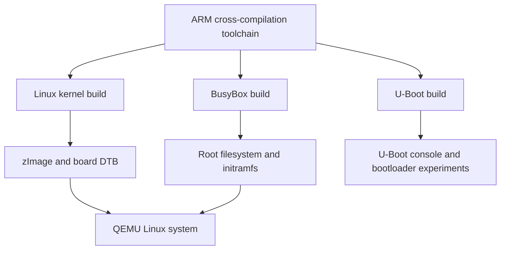
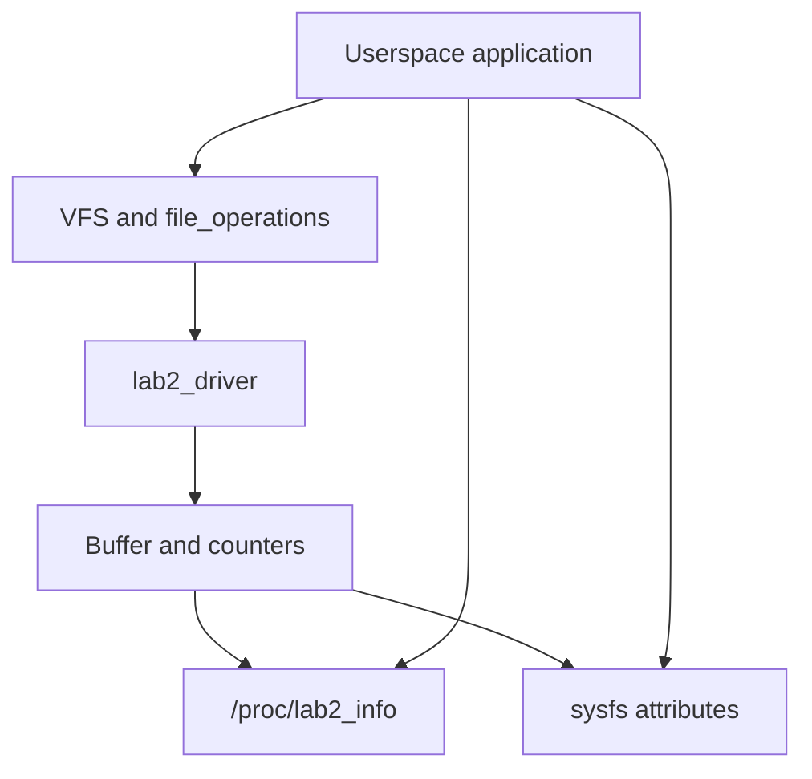
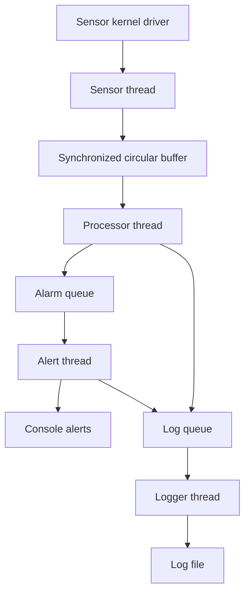

# LOS201 – Embedded Linux Systems

Group coursework repository for **LOS201 – Embedded Linux Systems** at
**FPT University**.

This repository brings together our practical work on ARM Linux system
construction, device drivers, flash filesystems, application debugging,
performance analysis, and a sensor monitoring application.

The coursework is organized so that the lecturer and other readers can find
each contributor's source code, configuration files, technical reports, and
supporting evidence.

## Contents

- [Team Members](#team-members)
- [Technical Platform](#technical-platform)
- [Coursework and Upload Information](#coursework-and-upload-information)
- [Repository Organization](#repository-organization)
- [LAB01 – ARM Linux System Build and Boot](#lab01--arm-linux-system-build-and-boot)
- [LAB02 – Device Driver and Filesystem Management](#lab02--device-driver-and-filesystem-management)
- [LAB03 – Debugging and Performance Analysis](#lab03--debugging-and-performance-analysis)
- [Assignment 1 – How to Write a Device Driver](#assignment-1--how-to-write-a-device-driver)
- [Assignment 2 – Sensor Monitoring System](#assignment-2--sensor-monitoring-system)
- [Reports and Evidence](#reports-and-evidence)
- [Team Collaboration](#team-collaboration)

## Team Members

| Full Name | Student ID |
|---|---|
| Trần Thiên Phúc | SE203798 |
| Nguyễn Huy Hoàng | SE203347 |
| Đinh Quang Ngọc | SE201573 |
| Võ Quốc Thịnh | SE200595 |

**Repository owner:** Trần Thiên Phúc.

GitHub accounts will be added when available.
The contributor responsible for each submission is identified in its own
documentation and commit history.

## Technical Platform

The ARM system used for LAB01 and LAB02 provides the foundation for the
later coursework.

| Component | Platform / Version |
|---|---|
| Development host | Ubuntu Linux |
| Target architecture | ARMv7-A |
| Target CPU | Cortex-A9 |
| Emulated board | QEMU `vexpress-a9` |
| Linux kernel | 5.15 |
| Bootloader | U-Boot 2022.04 |
| Minimal userspace | BusyBox 1.35.0 |
| Cross-compilation prefix | `arm-linux-gnueabihf-` |
| Source languages | C and shell scripts |
| Build system | GNU Make / kernel module Makefiles |
| Debugging and analysis tools | GDB, gdbserver, Valgrind, strace, perf, and cyclictest |

Host and ARM target programs use different binaries. Kernel modules must
match the architecture and kernel build of the system where they are loaded.
Exact commands and environment details belong in the documentation for each
coursework item.

## Coursework and Upload Information

All five coursework items are reported as completed by the team. Repository
publication is separate from practical completion: the materials for LAB03
and Assignment 2 are awaiting upload by their respective contributors.

| Coursework | Main Topic | Completion | Repository Materials | Contributor |
|---|---|---|---|---|
| [LAB01](lab01/) | ARM Linux build and boot | Completed | Uploaded | Trần Thiên Phúc |
| [LAB02](lab02/) | Device driver, procfs/sysfs, and JFFS2 | Completed | Uploaded | Trần Thiên Phúc |
| LAB03 | Debugging, memory analysis, profiling, and latency | Completed — team-reported | Upload pending | To be added |
| [Assignment 1](asgn01/Assignment%201/) | IOCTL and miscellaneous device drivers | Completed | Uploaded | Nguyễn Huy Hoàng |
| Assignment 2 | Sensor Monitoring System | Completed — team-reported | Upload pending | To be added |

LAB03 and Assignment 2 are described below by their coursework scope. Their
implementation details, measured results, contributor names, and file links
will be added with the actual submissions.

## Repository Organization

| Existing Directory | Contents |
|---|---|
| `lab01/configs/` | Linux kernel and BusyBox configuration files |
| `lab01/rootfs/` | Selected startup files for the root filesystem |
| `lab01/evidence/` | Kernel build and troubleshooting logs |
| `lab01/report/` | LAB01 Word and PDF reports |
| `lab02/driver/` | Character device driver source and Makefile |
| `lab02/rootfs/` | Startup script with automatic driver loading |
| `lab02/jffs2/` | JFFS2 image and test data |
| `lab02/evidence/` | Selected kernel build logs |
| `lab02/report/` | LAB02 Word and PDF reports |
| `asgn01/Assignment 1/task1_ioctl/` | IOCTL driver, shared header, module, and tests |
| `asgn01/Assignment 1/task2_misc/` | Counter driver, module, and tests |
| `asgn01/Assignment 1/logs/` | Test output and recorded QEMU/kernel sessions |
| `asgn01/Assignment 1/bao_cao/` | Assignment 1 PDF report |

LAB03 and Assignment 2 directories will be linked after upload. The table
above describes the existing repository layout rather than a proposed
directory tree.

Complete upstream Linux, U-Boot, and BusyBox source trees are not included.
The repository contains selected coursework materials, and additional build
outputs or reproduction instructions may be provided by each contributor.

## LAB01 – ARM Linux System Build and Boot

**Contributor:** Trần Thiên Phúc.

### Overview

LAB01 builds the main components of an embedded Linux system for an ARMv7
target. It covers cross-compilation, board configuration, bootloader testing,
minimal userspace construction, and booting Linux in QEMU.

### Technical Scope

| Area | Work Covered |
|---|---|
| Linux kernel | Configure Linux 5.15 for VExpress, cross-compile the kernel, and produce the kernel image and device tree |
| U-Boot | Build U-Boot 2022.04 for the Cortex-A9 board and inspect its console and boot environment |
| BusyBox | Configure and build BusyBox 1.35.0 for the ARM target |
| Root filesystem | Prepare userspace directories, initialization files, and virtual filesystem mounts |
| Initramfs | Package the root filesystem for use by QEMU |
| Verification | Inspect the running kernel, CPU, memory, device nodes, mounts, and processes |

### Component Relationship

The diagram separates the Linux direct-boot inputs from the U-Boot
experiments. A QEMU command using `-kernel`, `-dtb`, and `-initrd` boots Linux
directly; it does not demonstrate a U-Boot-mediated Linux boot by itself.

### Available Materials

- [Kernel and BusyBox configurations](lab01/configs/)
- [Root filesystem startup files](lab01/rootfs/)
- [Build and troubleshooting evidence](lab01/evidence/)
- [LAB01 report](lab01/report/)

The report explains the build process, encountered issues, and recorded boot
results. Build logs document compilation; the report provides the associated
runtime evidence.

## LAB02 – Device Driver and Filesystem Management

**Contributor:** Trần Thiên Phúc.

### Overview

LAB02 extends the LAB01 system with a loadable character device driver,
diagnostic interfaces, MTD/JFFS2 experiments, and automatic module loading
during userspace startup.

### Technical Scope

- **Character device:** `lab2_driver` supports `open`, `read`, `write`, and
  `release` through `/dev/lab2`, with major number `240` and minor `0`.
- **Userspace/kernel data exchange:** driver operations use
  `copy_from_user()` and `copy_to_user()` for buffer transfers.
- **Shared state:** the implementation includes a 1024-byte buffer and mutex
  protection for shared driver data.
- **procfs:** `/proc/lab2_info` exposes a readable summary of driver state.
- **sysfs:** attributes under `/sys/class/lab2_class/lab2/` expose
  `buffer_len`, `open_count`, and `last_data`.
- **MTD/JFFS2:** the filesystem exercise covers flash simulation, filesystem
  image creation, read/write operations, and unmount/remount verification.
- **Boot integration:** `rcS` mounts virtual filesystems, loads the module,
  and ensures that `/dev/lab2` is available for testing.

### Driver Interfaces

The character device transfers application data. procfs and sysfs provide
additional views of driver state. The MTD/JFFS2 experiment is a separate
filesystem exercise, not storage implemented by `lab2_driver`.

### Available Materials

- [Driver source and Makefile](lab02/driver/)
- [Automatic startup script](lab02/rootfs/etc/init.d/rcS)
- [JFFS2 image and test data](lab02/jffs2/)
- [Kernel build evidence](lab02/evidence/)
- [LAB02 report](lab02/report/)

The JFFS2 image is a binary artifact. Its contents should be inspected with
appropriate filesystem tools rather than GitHub's text preview.

## LAB03 – Debugging and Performance Analysis

**Completion:** reported completed by the team.

**Repository upload:** pending.

**Contributor:** to be added with the submission.

### Overview

LAB03 covers debugging and performance analysis for embedded Linux
applications. Its four practical parts address application faults, memory
management, system-call/CPU profiling, and scheduling latency.

### Technical Scope

| Part | Tools | Focus |
|---|---|---|
| A – Remote debugging | GDB multiarch and gdbserver | Breakpoints, watchpoints, call stacks, variable inspection, and analysis of faulty C code |
| B – Memory analysis | Valgrind Memcheck | Identify allocation leaks, correct memory ownership, and compare results before and after fixes |
| C – Application profiling | strace and perf | Analyze system calls, CPU hotspots, and possible optimizations |
| D – Real-time analysis | cyclictest and histogram plots | Measure scheduling latency and explain the effect of kernel preemption |

The lab distinguishes target debugging from host analysis. In the supplied
workflow, Valgrind analysis and cyclictest measurements run on the Ubuntu
host. QEMU timing should not be presented as a physical hardware real-time
benchmark.

The required standard-kernel measurements are accompanied by an explanation
of PREEMPT_RT. An actual RT-kernel comparison is an additional experiment
and should be identified separately if performed.

### Submission Materials

The contributor's upload will provide the application sources, corrected
versions, debugging sessions, profiling logs, latency data/plots, and report.
Measured values and demonstrated outcomes will be documented with those files.

## Assignment 1 – How to Write a Device Driver

**Contributor:** Nguyễn Huy Hoàng.

### Overview

Assignment 1 develops two device drivers: a character driver with an IOCTL
interface and a counter device using the Linux miscellaneous device framework.
It also includes design analysis, testing evidence, and theoretical discussion.

### Task 1 – IOCTL Character Driver

The `asgn1_driver` implementation provides `/dev/asgn1` with major number
`241` and supports the following control operations:

| Operation | Purpose |
|---|---|
| Reset buffer | Clear stored data and reset read/write statistics |
| Get statistics | Return driver counters and buffer information to userspace |
| Set mode | Select echo mode or the mode that adds a `[KERNEL]` prefix |
| Get version | Return the driver's version string |

The shared IOCTL header defines the command interface used by both the kernel
module and its userspace test program.

### Task 2 – Miscellaneous Counter Device

- Registers `/dev/counter` through the `miscdevice` framework.
- Returns the counter value and advances it during the defined read operation.
- Accepts a valid non-negative value through `write` to set or reset the counter.
- Exposes statistics through `/proc/counter_info`.
- Includes tests for invalid input and partial-read behavior.

### Tasks 3 and 4 – Analysis and Theory

The report covers driver architecture, character/block/network device
comparisons, registration choices, synchronization, IOCTL design, and relevant
kernel concepts. Test output and kernel logs support the implementation review.

### Available Materials

- [Assignment documentation](asgn01/Assignment%201/README.md)
- [IOCTL driver and tests](asgn01/Assignment%201/task1_ioctl/)
- [Counter driver and tests](asgn01/Assignment%201/task2_misc/)
- [Test and kernel logs](asgn01/Assignment%201/logs/)
- [Assignment report](asgn01/Assignment%201/bao_cao/)

These materials were contributed by Hoang through his own GitHub account.
They remain associated with his original commits and pull requests.

## Assignment 2 – Sensor Monitoring System

**Completion:** reported completed by the team.

**Repository upload:** pending.

**Contributor:** to be added with the submission.

### Overview

Assignment 2 integrates device driver development, POSIX threads,
inter-process communication, memory analysis, debugging, and real-time
scheduling in a Sensor Monitoring System (SMS).

### Coursework Architecture

This diagram summarizes the coursework architecture. The contributor's final
report will describe any implementation-specific choices.

### Technical Scope

| Task | Focus |
|---|---|
| 1 – Application architecture | Sensor driver, four worker threads, circular buffer, message queues, runtime configuration, and orderly shutdown |
| 2 – Memory and driver integration | Allocation lifecycle, process memory footprint, device IOCTL configuration, and driver statistics |
| 3 – Debugging and profiling | GDB sessions, Valgrind analysis, system-call tracing, and CPU profiling |
| 4 – Real-time analysis | Sampling interval, scheduling policy, latency/jitter measurements, and optimization discussion |
| 5 – Report and demonstration | Architecture explanation, test evidence, technical report, and demonstration video |

The design uses a simulated temperature/humidity device exposed through
`/dev/sms_sensor`, with diagnostics through `/proc/sms_stats`. Sensor samples
pass through a synchronized buffer before processing, alerting, and logging.

No benchmark values are included here before the contributor's evidence is
uploaded. Timing results, memory measurements, and test outcomes belong with
their recorded environment and reproducible procedure.

### Submission Materials

The contributor's upload will provide driver and application sources,
Makefiles, test/profiling logs, architecture documentation, the technical
report, and a demonstration video or link.

## Reports and Evidence

### Currently Available

- [LAB01 Word/PDF reports](lab01/report/)
- [LAB02 Word/PDF reports](lab02/report/)
- [Assignment 1 PDF report](asgn01/Assignment%201/bao_cao/)

### Documentation Conventions

Each coursework submission should identify its contributor and explain:

1. The objective and relevant environment.
2. The source, configuration, and build/run procedure.
3. The test commands and what their output means.
4. The actual logs, screenshots, diagrams, or measurements.
5. Encountered problems, fixes, and remaining limitations.

Compilation logs, runtime logs, and expected example output serve different
purposes and should be labelled accordingly. Screenshots and measurements
must correspond to the contributor's own execution.

## Team Collaboration

Each member develops and uploads their assigned work using their own GitHub
account. The repository owner maintains shared navigation and introductory
documentation.

- Use a personal or task-specific branch for changes.
- Commit meaningful units of work as development progresses.
- Push updates regularly so the lecturer can follow individual work.
- Submit a pull request describing the change and relevant checks.
- Merge reviewed contributions into `main`.
- Keep the original contributor identified in coursework documentation.

Commit history and pull requests document individual contributions. Practical
completion and the availability of files in this repository are recorded
separately; pending uploads remain the responsibility of their contributors.

## Archived Work

LAB01 and LAB02 were completed by Trần Thiên Phúc before this group
repository was created and were subsequently uploaded as archived work.
Their upload commits do not represent a step-by-step development history.

For subsequent work and revisions, the team records changes incrementally
through commits and pull requests.

## References

- Course lab and assignment specifications supplied by the lecturer.
- [Linux kernel documentation](https://docs.kernel.org/)
- [U-Boot documentation](https://docs.u-boot.org/)
- [BusyBox](https://busybox.net/)
- [QEMU documentation](https://www.qemu.org/docs/master/)

Implementation-specific references belong in the corresponding technical
report.
