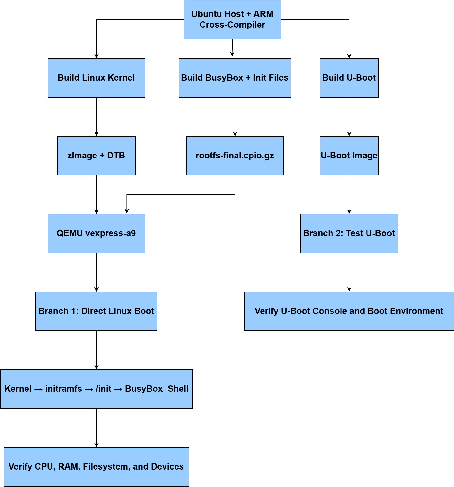
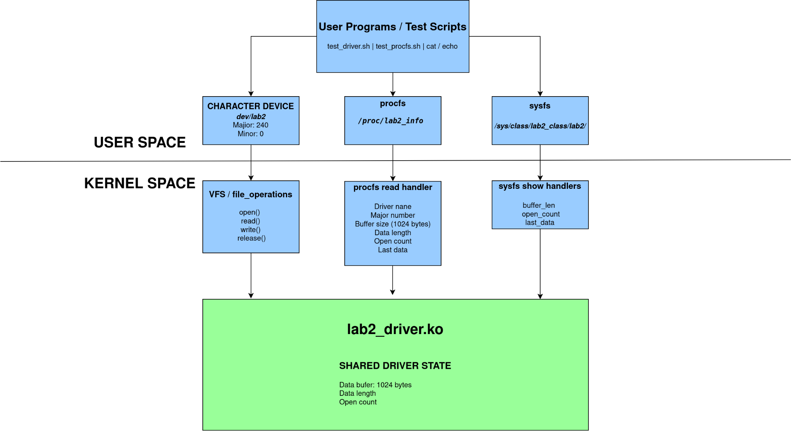

# LOS201 – Embedded Linux Systems

**FPT University · Group Coursework Portfolio**

This repository presents our completed coursework for **LOS201 – Embedded
Linux Systems**, comprising **three laboratory exercises and two assignments**.
The work covers building an ARM Linux environment, developing kernel device
drivers, working with flash filesystems, debugging and profiling applications,
and designing a multithreaded Sensor Monitoring System.

This README provides a shared introduction, contributor information, technical
overviews, and navigation to the coursework materials. Individual guides provide
the build commands, implementation details, recorded tests, and explanations
needed to review and reproduce the documented experiments.

**Explore:** [Coursework Overview](#coursework-overview) · [LAB01 Quick Start](lab01/README.md#quick-start) · [LAB02 Guide](lab02/README.md) · [Assignment 1 Guide](assignment01/README.md) · [Assignment 2 Guide](assignment02/README.md) · [Reports and Evidence](#reports-and-evidence)

## Contents

- [Team Members](#team-members)
- [Coursework Overview](#coursework-overview)
- [Technical Platform](#technical-platform)
- [Repository Organization](#repository-organization)
- [Getting Started](#getting-started)
- [LAB01 – ARM Linux System Build and Boot](#lab01--arm-linux-system-build-and-boot)
- [LAB02 – Device Driver and Filesystem Management](#lab02--device-driver-and-filesystem-management)
- [LAB03 – Debugging and Performance Analysis](#lab03--debugging-and-performance-analysis)
- [Assignment 1 – How to Write a Device Driver](#assignment-1--how-to-write-a-device-driver)
- [Assignment 2 – Sensor Monitoring System](#assignment-2--sensor-monitoring-system)
- [Reports and Evidence](#reports-and-evidence)
- [Team Collaboration](#team-collaboration)
- [References](#references)

## Team Members

| Full Name | Student ID | Assigned Coursework |
|---|---|---|
| Trần Thiên Phúc | SE203798 | LAB01; Assignment 2 (shared) |
| Nguyễn Huy Hoàng | SE203347 | Assignment 1; Assignment 2 (shared) |
| Đinh Quang Ngọc | SE201573 | LAB03; Assignment 2 (shared) |
| Võ Quốc Thịnh | SE200595 | LAB02; Assignment 2 (shared) |

**Repository owner and shared documentation maintainer:** Trần Thiên Phúc.

Members lead the laboratory exercises and Assignment 1 listed above.
**Assignment 2 is a shared project completed by all four team members:**
Trần Thiên Phúc, Nguyễn Huy Hoàng, Đinh Quang Ngọc, and Võ Quốc Thịnh.
Commits and pull requests preserve the contribution history of the accounts
that submitted each change; upload ownership does not imply sole project authorship.

## Coursework Overview

The five completed coursework items develop complementary skills across the
embedded Linux software stack, from the boot environment to kernel interfaces
and concurrent userspace applications.

| Coursework | Main Topic | Contributor |
|---|---|---|
| [LAB01](lab01/README.md) | ARM kernel, U-Boot, BusyBox, root filesystem, and QEMU boot | Trần Thiên Phúc |
| [LAB02](lab02/README.md) | Character device driver, procfs/sysfs, MTD/JFFS2, and boot integration | Võ Quốc Thịnh |
| [LAB03](lab03/README.md) | Debugging, memory analysis, profiling, and scheduling latency | Đinh Quang Ngọc |
| [Assignment 1](assignment01/README.md) | IOCTL character driver and miscellaneous counter device | Nguyễn Huy Hoàng |
| [Assignment 2](assignment02/README.md) | Multithreaded Sensor Monitoring System, driver integration, and analysis | All four team members |

## Technical Platform

| Component | Platform / Version |
|---|---|
| Development host | Ubuntu Linux |
| Target architecture | ARMv7-A |
| Target CPU | Cortex-A9 |
| Emulated board | QEMU `vexpress-a9` |
| Linux kernel | 5.15 |
| Bootloader | U-Boot 2022.04 |
| Minimal userspace | BusyBox 1.35.0 |
| Cross-compilation prefix | `arm-linux-gnueabihf-` |
| Implementation languages | C and shell scripts |
| Build tools | GNU Make and the Linux kernel module build system |
| Debugging tools | GDB, gdbserver, and Valgrind |
| Profiling and latency tools | strace, perf, and cyclictest |

LAB01 establishes the ARM environment used as the foundation for the driver
experiments. Some analysis exercises run on the Ubuntu host; others run on the
ARM target. The individual guides identify the relevant environment and commands.

Host executables and ARM executables are different build outputs. A kernel
module must match the target architecture and the running kernel's version and
configuration. The U-Boot console experiment and the direct Linux boot
experiment are documented as separate execution paths.

## Repository Organization

| Location | Contents |
|---|---|
| [README.md](README.md) | Shared introduction, team responsibilities, coursework architecture, and navigation |
| [.gitignore](.gitignore) | Rules for excluding local build and temporary files from new commits |
| [lab01/README.md](lab01/README.md) | Build instructions, Quick Start, verification, and troubleshooting |
| [lab01/configs/](lab01/configs/) | Linux, U-Boot, and BusyBox configurations |
| [lab01/rootfs/](lab01/rootfs/) | Selected initialization and root filesystem files |
| [lab01/output/](lab01/output/) | Tested ARM kernel image, board device tree, and initramfs |
| [lab01/evidence/](lab01/evidence/) | Build, troubleshooting, boot, and runtime validation logs |
| [lab01/report/](lab01/report/) | LAB01 Word and PDF reports |
| [lab02/README.md](lab02/README.md) | Driver setup, build, execution, testing, and recorded results |
| [lab02/driver_architecture.png](lab02/driver_architecture.png) | LAB02 architecture and driver interface diagram |
| [lab02/driver/](lab02/driver/) | Character device driver source, Makefile, and compiled module |
| [lab02/rootfs/](lab02/rootfs/) | Boot integration files and test scripts |
| [lab02/evidence/](lab02/evidence/) | Original execution logs and readable excerpts in `clean/` |
| [lab02/report/](lab02/report/) | LAB02 PDF report |
| [assignment01/](assignment01/) | Assignment guide, IOCTL and counter drivers, tests, logs, and PDF report |
| [lab03/](lab03/) | Debugging/performance guide, applications, logs, boot image, and report |
| [assignment02/README.md](assignment02/README.md) | Shared Sensor Monitoring System guide and recorded results |
| [assignment02/app/](assignment02/app/) | Application source, ARM binary `sms_app`, and native binary `sms_app_x86` |
| [assignment02/driver/](assignment02/driver/) | Sensor driver source, IOCTL header, Makefile, and ARM module |
| [assignment02/output/](assignment02/output/) | Tested Assignment 2 initramfs |
| [assignment02/logs/](assignment02/logs/) | Runtime, memory, debugging, profiling, and scheduling evidence |
| [assignment02/report/](assignment02/report/) | Group-uploaded Assignment 2 report |

The sections below explain the technical scope of all five coursework items.
Upstream Linux, U-Boot, and BusyBox source trees can be obtained using the
versions and instructions in the individual build guides.

## Getting Started

1. Use the [coursework table](#coursework-overview) to find a topic and its contributor.
2. For a working ARM Linux environment, follow the [LAB01 Quick Start](lab01/README.md#quick-start). It uses the supplied kernel image, device tree, and initramfs.
3. For driver and filesystem experiments, follow the [LAB02 guide](lab02/README.md) or [Assignment 1 guide](assignment01/README.md), including their kernel and module requirements.
4. For the Sensor Monitoring System, follow the [Assignment 2 guide](assignment02/README.md). Use its packaged initramfs with the matching assignment kernel; the guide distinguishes ARM execution from native host analysis.
5. Review the source alongside the [reports and execution evidence](#reports-and-evidence) to connect the implementation with its recorded behavior.

The LAB01 boot files demonstrate the LAB01 environment. LAB02 boot integration
and additional drivers require the preparation described in their own guides;
they are not automatically included in the LAB01 initramfs.

## LAB01 – ARM Linux System Build and Boot

**Contributor:** Trần Thiên Phúc.

### Overview

LAB01 builds the main components of an embedded Linux system for an ARMv7
target. It covers cross-compilation, board configuration, bootloader testing,
minimal userspace construction, and booting Linux in QEMU.

### Technical Scope

| Area | Work Covered |
|---|---|
| Linux kernel | Configure Linux 5.15 for VExpress, cross-compile the kernel, and produce the kernel image and device tree |
| U-Boot | Build U-Boot 2022.04 for the Cortex-A9 board and inspect its console and boot environment |
| BusyBox | Configure and build BusyBox 1.35.0 for the ARM target |
| Root filesystem | Prepare userspace directories, initialization files, and virtual filesystem mounts |
| Initramfs | Package the root filesystem for use by QEMU |
| Verification | Inspect the running kernel, CPU, memory, device nodes, mounts, and processes |

### Build and Execution Architecture



*Figure 1. LAB01 Build and Execution Architecture.*

The diagram summarizes the LAB01 build and execution workflow. The ARM cross-compiler is used to build the Linux kernel, BusyBox root filesystem, and U-Boot. Direct Linux boot in QEMU and U-Boot console testing are carried out as separate experiments.

The tested Linux command passes `zImage`, the board DTB and the initramfs directly to QEMU. U-Boot is built and exercised in its own console session. The [LAB01 guide](lab01/README.md) explains both execution paths.

### Available Materials

- [LAB01 guide and Quick Start](lab01/README.md#quick-start)
- [Linux, U-Boot and BusyBox configurations](lab01/configs/)
- [Root filesystem startup files](lab01/rootfs/)
- [Tested boot images](lab01/output/)
- [Boot and runtime validation log](lab01/evidence/boot_validation.log)
- [Build and troubleshooting logs](lab01/evidence/)
- [Word and PDF reports](lab01/report/)

The runtime log records Linux 5.15.0 on ARMv7, hostname `embedded-lab`, two online CPUs, the required virtual filesystem mounts, init at PID 1 and the expected device nodes. The reports explain the practical workflow and include screenshots.

## LAB02 – Device Driver and Filesystem Management

**Contributor:** Võ Quốc Thịnh.

### Overview

LAB02 extends the LAB01 system with a loadable character device driver,
diagnostic interfaces, MTD/JFFS2 experiments, and automatic module loading
during userspace startup. For build instructions, test commands, and recorded
results, see the [LAB02 guide](lab02/README.md).

### Technical Scope

| Part | Focus |
|---|---|
| A – Character device driver | Build and load a kernel module, expose a device node, and test open/read/write/release operations |
| B – procfs and sysfs | Export driver state and inspect the relationship between device operations, counters, and diagnostic attributes |
| C – MTD/JFFS2 | Simulate flash storage, create a JFFS2 image, and verify filesystem operations and unmount/remount behavior |
| D – Boot integration | Prepare initialization files and automate module loading during startup |

The uploaded driver exposes `/dev/lab2` with major number `240` and minor number `0`. It maintains a 1024-byte buffer, its current data length and an open counter. procfs and sysfs provide diagnostic views of this state.

### Driver Interfaces

The following diagram illustrates the LAB02 character device driver, its procfs/sysfs interfaces, and shared kernel state. The same figure is included in the [LAB02 guide](lab02/README.md#driver-architecture-and-interfaces).



*Figure 1. LAB02 Character Device Driver Architecture and Interfaces.*

The arrows show the routes used to access the driver and inspect its state. Character device operations pass through `file_operations`; procfs uses a `seq_file` callback; sysfs exposes read-only device attributes.

| Interface | Purpose |
|---|---|
| `/dev/lab2` | Open, read, write and release the character device |
| `/proc/lab2_info` | Read driver statistics and the last stored data |
| `/sys/class/lab2_class/lab2/` | Read `buffer_len`, `open_count` and `last_data` attributes |

MTD/JFFS2 is a separate flash-filesystem exercise. Its [recorded session](lab02/evidence/mtd_jffs2.txt) includes image creation, mounting, file operations and persistence checks across an unmount/remount cycle.

### Available Materials

- [LAB02 README: setup, execution, testing, and limitations](lab02/README.md)
- [Driver architecture PNG](lab02/driver_architecture.png)
- [Driver source, Makefile, and compiled module](lab02/driver/)
- [Boot integration files](lab02/rootfs/etc/)
- [Device and procfs/sysfs test scripts](lab02/rootfs/usr/bin/)
- [Boot log](lab02/evidence/boot_log.txt)
- [Character device test session](lab02/evidence/driver_test.txt)
- [procfs/sysfs test session](lab02/evidence/procfs_test.txt)
- [MTD/JFFS2 session](lab02/evidence/mtd_jffs2.txt)
- [Clean execution log excerpts](lab02/evidence/clean/)
- [LAB02 PDF report](lab02/report/SE200595_Lab02_BaoCao.pdf)

The original logs preserve the execution transcripts; the clean excerpts
present selected outputs for easier review and are not separate test runs.

## LAB03 – Debugging and Performance Analysis

**Course:** Embedded Linux Systems  
**Lab:** 03 – Debugging and Performance Analysis  
**Platform:** Ubuntu Linux (Host) / ARMv7 Cortex-A9 (QEMU Target)  
**Language:** C  
**Contributor:** Đinh Quang Ngọc

### 1. Overview

This lab focuses on debugging, memory analysis, system-call tracing, CPU profiling, and real-time scheduling latency in an Embedded Linux environment.

The main tools are **GDB Multiarch, Valgrind, strace, perf, and cyclictest**.

### 2. System Architecture


Host-native analysis tools run on Ubuntu; ARM application debugging uses the QEMU target.

### 3. Lab Activities

| Part | Tool | Main Objective |
|---|---|---|
| A | GDB / GDB Multiarch | Identify and fix C programming bugs |
| B | Valgrind | Detect and fix memory leaks |
| C | strace / perf | Analyze system calls and CPU performance |
| D | cyclictest | Measure scheduling latency |

#### Part A – GDB Debugging

Debug `buggy_app` to investigate:

- Array out-of-bounds access
- Use-after-free
- Integer overflow

Use breakpoints, variable inspection, and backtraces to identify defects and verify corrections.

#### Part B – Memory Analysis

Run Valgrind on `leaky_app` to detect memory leaks and compare the original and corrected versions.

#### Part C – Performance Analysis

Use `strace` to inspect system calls and `perf` to identify CPU-intensive functions and performance bottlenecks.

#### Part D – Real-Time Latency

Use `cyclictest` to measure scheduling latency, collect histogram data, and compare results under different system configurations.

### 4. Project Structure

```text
lab03/
├── apps/
│   ├── buggy_app.c
│   ├── buggy_app
│   ├── leaky_app.c
│   ├── leaky_app_fixed.c
│   └── perf_target.c
├── logs/
│   ├── gdb_session.txt
│   ├── valgrind_report.txt
│   ├── valgrind_fixed.txt
│   ├── strace_summary.txt
│   ├── perf_stat.txt
│   ├── perf_report.txt
│   └── hist_standard.txt
├── output/
│   └── initramfs_lab3.cpio.gz
├── baocao/
│   └── Lab03_Report.pdf
└── README.md
```

*The structure is a recommended group layout; actual filenames may differ.*

### 5. Basic Commands

**GDB Remote Debugging**

On the ARM target:

```bash
gdbserver :1234 ./buggy_app
```

On the Ubuntu host:

```bash
gdb-multiarch ./buggy_app
```

Inside GDB:

```gdb
target remote :1234
break main
continue
```

**Valgrind**

```bash
valgrind --leak-check=full ./leaky_app
```

**strace**

```bash
strace -c ./leaky_app
```

**perf**

```bash
perf stat ./perf_target
perf record ./perf_target
perf report
```

**cyclictest**

```bash
sudo cyclictest --mlockall --threads=4 \
  --priority=80 --interval=1000 \
  --loops=10000
```

Commands must be executed in the appropriate host or target environment. Remote GDB requires a working network connection and matching executable symbols.

### 6. Expected Deliverables

- Source code and executable files
- Original and corrected program versions
- GDB debugging evidence
- Valgrind memory analysis reports
- strace and perf results
- cyclictest latency measurements and histogram
- Group report with screenshots, analysis, and conclusions

### 7. Conclusion

Lab 03 demonstrates essential techniques for debugging and evaluating Embedded Linux applications. The experiments help identify software defects, detect memory problems, investigate performance bottlenecks, and evaluate scheduling latency.

The collected logs and measurements provide evidence for the group's technical report.

### Available Materials

- [LAB03 guide](lab03/README.md)
- [Application sources](lab03/apps/)
- [Execution and analysis logs](lab03/logs/)
- [Packaged boot environment](lab03/output/)
- [LAB03 PDF report](lab03/report/SE201573_DinhQuangNgoc_Lab03_Report.pdf)

## Assignment 1 – How to Write a Device Driver

**Contributor:** Nguyễn Huy Hoàng.

### Overview

Assignment 1 develops two device drivers: a character driver with an IOCTL
interface and a counter device using the Linux miscellaneous device framework.
It also includes design analysis, testing evidence, and theoretical discussion.

### Task 1 – IOCTL Character Driver

The `asgn1_driver` implementation provides `/dev/asgn1` with major number
`241` and supports the following control operations:

| Operation | Purpose |
|---|---|
| Reset buffer | Clear stored data and reset read/write statistics |
| Get statistics | Return driver counters and buffer information to userspace |
| Set mode | Select echo mode or the mode that adds a `[KERNEL]` prefix |
| Get version | Return the driver's version string |

The shared IOCTL header defines the command interface used by both the kernel
module and its userspace test program.

### Task 2 – Miscellaneous Counter Device

- Registers `/dev/counter` through the `miscdevice` framework.
- Returns the counter value and advances it during the defined read operation.
- Accepts a valid non-negative value through `write` to set or reset the counter.
- Exposes statistics through `/proc/counter_info`.
- Includes tests for invalid input and partial-read behavior.

### Tasks 3 and 4 – Analysis and Theory

The report covers driver architecture, character/block/network device
comparisons, registration choices, synchronization, IOCTL design, and relevant
kernel concepts. Test output and kernel logs support the implementation review.

### Available Materials

- [Assignment documentation](assignment01/README.md)
- [IOCTL driver and tests](assignment01/task1_ioctl/)
- [Counter driver and tests](assignment01/task2_misc/)
- [Test and kernel logs](assignment01/logs/)
- [Assignment report](assignment01/bao_cao/)

Hoàng's commits and pull requests preserve the authorship of this submission.

# Assignment 02 — Embedded Linux Sensor Monitoring System

**Course:** LOS201 — Embedded Linux Systems, FPT University

**Contributors:**
- Trần Thiên Phúc
- Nguyễn Huy Hoàng
- Đinh Quang Ngọc
- Võ Quốc Thịnh

## Overview

This assignment implements an Embedded Linux Sensor Monitoring System using a custom Linux kernel driver and a multithreaded C application running on QEMU ARM.

The system collects sensor readings, processes data, generates threshold-based alerts, and records monitoring events. It also demonstrates IOCTL communication, debugging, performance profiling, and real-time scheduling.

## Platform

| Component | Configuration |
|---|---|
| Development Host | Ubuntu Linux (x86-64) |
| Target Architecture | ARMv7-A |
| Target CPU | Cortex-A9 |
| QEMU Machine | `vexpress-a9` |
| Linux Kernel | 5.15 |
| Cross-Compiler | `arm-linux-gnueabihf-` |
| Programming Language | C |
| Scheduling Policy | SCHED_FIFO |

## System Architecture


The monitoring system consists of a Linux kernel driver and four POSIX threads.

| Component | Function |
|---|---|
| Sensor Driver | Provides sensor readings through `/dev/sms_sensor` |
| Sensor Thread | Collects sensor samples |
| Circular Buffer | Stores up to 16 samples with synchronized access |
| Processor Thread | Processes sensor readings |
| Alert Thread | Handles threshold alerts |
| Logger Thread | Records monitoring events in `/sms.log` |

POSIX message queues provide communication between the Processor, Alert, and Logger threads.

## Repository Materials

```text
Assignment02/
├── driver/
│   ├── sms_sensor.c
│   └── Makefile
├── include/
│   └── sms_ioctl.h
├── src/
│   └── sms_app.c
├── tests/
│   ├── ioctl_test.c
│   ├── valgrind/
│   ├── strace/
│   └── perf/
├── qemu_rootfs/
├── images/
│   └── asm2_block_diagram.png
├── report/
├── initramfs_asgn2.cpio.gz
└── README.md
```

The `report/` directory is intended for the group's final documentation. Generated binaries and additional testing files may vary.

## Assignment Tasks

| Task | Description |
|---|---|
| Task 1 | Multithreaded Sensor Monitoring System |
| Task 2 | IOCTL Interface and Memory Management |
| Task 3 | Debugging and Performance Profiling |
| Task 4 | Real-Time Scheduling and Jitter Measurement |
| Task 5 | Documentation and Demonstration |

### Task 1 — Sensor Monitoring

Implement four POSIX threads, a synchronized circular buffer, POSIX message queues, threshold alerts, logging, and graceful shutdown.

### Task 2 — IOCTL Interface

The driver supports four IOCTL operations:

- `SMS_IOCTL_SET_CONFIG`
- `SMS_IOCTL_GET_CONFIG`
- `SMS_IOCTL_GET_STATS`
- `SMS_IOCTL_RESET_STATS`

### Task 3 — Debugging and Profiling

Use GDB Multiarch, Valgrind, strace, and perf to inspect application behavior, detect memory errors, trace system calls, and evaluate performance.

### Task 4 — Real-Time Scheduling

Use `SCHED_FIFO` with the following thread priorities:

| Thread | Priority |
|---|---:|
| Sensor | 80 |
| Processor | 70 |
| Alert | 60 |
| Logger | 50 |

The target sampling interval is **1000 ms**. Timing measurements are collected using `CLOCK_MONOTONIC`.

### Task 5 — Documentation

Prepare the final report, experimental evidence, screenshots, and project demonstration.

## Build and Run

### 1. Build Kernel Module

Run from the assignment directory:

```bash
make -C /path/to/linux-5.15 \
  M="$PWD/driver" \
  ARCH=arm \
  CROSS_COMPILE=arm-linux-gnueabihf- \
  KCFLAGS="-march=armv7-a" \
  modules
```

### 2. Compile ARM Application

```bash
arm-linux-gnueabihf-gcc \
  -march=armv7-a \
  -mfpu=vfpv3-d16 \
  -mfloat-abi=hard \
  -O2 -pthread -static \
  src/sms_app.c \
  -o sms_app_arm -lrt
```

### 3. Boot QEMU

After preparing the kernel image, device tree, and initramfs:

```bash
qemu-system-arm \
  -M vexpress-a9 \
  -cpu cortex-a9 \
  -m 256M \
  -kernel /path/to/zImage \
  -dtb /path/to/vexpress-v2p-ca9.dtb \
  -initrd initramfs_asgn2.cpio.gz \
  -append "console=ttyAMA0,115200 rdinit=/init" \
  -nographic
```

### 4. Run Sensor Monitoring

Inside QEMU:

```bash
insmod /lib/modules/5.15.0/extra/sms_sensor.ko
/sms_app_arm
```

Press **Ctrl+C** to request graceful shutdown.

## Testing and Verification

| Test | Verification |
|---|---|
| Kernel Module | Driver loads and provides sensor data |
| POSIX Threads | Four worker threads execute |
| Circular Buffer | Synchronized producer-consumer operation |
| Message Queues | Alert and logging communication |
| IOCTL | Configuration and statistics operations |
| GDB | Thread and variable inspection |
| Valgrind | Memory error and leak analysis |
| strace / perf | System-call and CPU profiling |
| SCHED_FIFO | Real-time priority configuration |
| Jitter | Sampling interval measurements |
| Shutdown | Thread termination and queue cleanup |

Recorded measurements may vary between QEMU runs and host environments.

## Troubleshooting

| Problem | Suggested Solution |
|---|---|
| Kernel module fails to load | Verify the module was built for the running ARM kernel |
| `/dev/sms_sensor` missing | Check driver loading and device creation |
| Message queue errors | Verify `/dev/mqueue` is mounted |
| Scheduling permission denied | Check real-time scheduling permissions |
| QEMU boot failure | Verify kernel, DTB, and initramfs paths |
| README diagram missing | Check `images/asm2_block_diagram.png` |

## Conclusion

Assignment 02 demonstrates the development and evaluation of an Embedded Linux Sensor Monitoring System.

The project integrates Linux kernel programming, POSIX multithreading, inter-process communication, debugging, performance profiling, and real-time scheduling.

### Available Materials

- [Assignment 2 guide, build instructions, and QEMU commands](assignment02/README.md)
- [Application sources and ARM/x86_64 binaries](assignment02/app/)
- [Sensor driver and ARM kernel module](assignment02/driver/)
- [Tested initramfs](assignment02/output/initramfs_asgn2.cpio.gz)
- [Runtime and analysis evidence](assignment02/logs/)
- [Paired SCHED_OTHER/SCHED_FIFO jitter results](assignment02/logs/jitter_report.txt)
- [Group-uploaded report](assignment02/report/bao_cao.pdf)


## Reports and Evidence

The following links provide direct access to published reports and execution
records. The individual guides explain the commands and context behind them.

| Coursework | Technical Report | Supporting Evidence |
|---|---|---|
| LAB01 | [PDF](lab01/report/BAO_CAO_LAB01_Embedded_Linux.pdf) · [Word](lab01/report/BAO_CAO_LAB01_Embedded_Linux.docx) | [Boot validation](lab01/evidence/boot_validation.log) · [Build and troubleshooting logs](lab01/evidence/) |
| LAB02 | [PDF](lab02/report/SE200595_Lab02_BaoCao.pdf) | [Original execution logs](lab02/evidence/) · [Readable excerpts](lab02/evidence/clean/) |
| Assignment 1 | [PDF](assignment01/bao_cao/SE203347_NguyenHuyHoang_Asgn01_BaoCao.pdf) | [Driver tests and kernel logs](assignment01/logs/) |
| LAB03 | [PDF](lab03/report/SE201573_DinhQuangNgoc_Lab03_Report.pdf) | [Debugging, memory, profiling, and latency logs](lab03/logs/) |
| Assignment 2 | [PDF](assignment02/report/bao_cao.pdf) | [Runtime and analysis logs](assignment02/logs/) · [Jitter comparison](assignment02/logs/jitter_report.txt) |

### Recorded Checks

- **LAB01:** the runtime validation log records Linux 5.15.0 on ARMv7, the `embedded-lab` hostname, CPU information, mounted virtual filesystems, initialization, and device nodes.
- **LAB02:** the sessions record module loading, character-device operations, procfs/sysfs inspection, and MTD/JFFS2 operations including persistence across an unmount/remount cycle.
- **Assignment 1:** test transcripts and kernel logs accompany the IOCTL driver and miscellaneous counter device implementations.
- **Assignment 2:** recorded evidence covers guest runtime/memory observations, GDB inspection, native Valgrind/strace/perf analysis, and two 1,050-sample QEMU scheduling runs. The freshly packaged image passed a separate short boot/application check.

LAB02's clean logs are selected excerpts of the original transcripts, not
additional independent test runs. Build logs, runtime output, screenshots, and
measured performance data each document different aspects of the work.

### Reading the Documentation

For each experiment, review the objective, environment, implementation,
build/run procedure, recorded output, and explanation of the results together.
Troubleshooting notes connect encountered problems with their fixes.
Performance figures are meaningful in the context of the system and workload
used to collect them; exact measurements belong in the corresponding report.

## Team Collaboration

Each member contributes through their own GitHub account. Laboratory exercises
and Assignment 1 have the leads listed above; all four members collaborate on
Assignment 2. The repository owner maintains the shared README and navigation.

The collaboration workflow uses personal or task-specific branches, meaningful
commits, regular pushes during development, and pull requests for review before
merging into `main`. Coursework documentation identifies the responsible member or contributing group,
while commit history and pull requests preserve contribution records.

Future corrections follow the same workflow: describe the change, check the
affected commands or links, and retain the original contributor's authorship.

## References

- LOS201 laboratory and assignment specifications supplied by the lecturer.
- [Linux kernel documentation](https://docs.kernel.org/)
- [U-Boot documentation](https://docs.u-boot.org/)
- [BusyBox](https://busybox.net/)
- [QEMU documentation](https://www.qemu.org/docs/master/)

Implementation-specific references and technical discussions are included in
the corresponding coursework documentation and reports.
