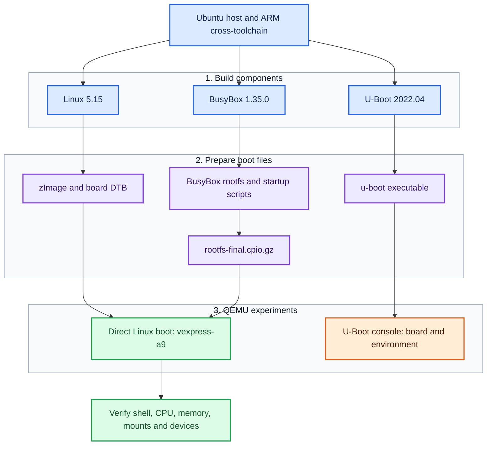
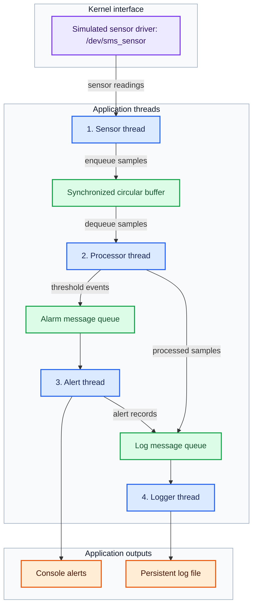

# LOS201 – Embedded Linux Systems

**FPT University · Group Coursework Portfolio**

This repository presents our completed coursework for **LOS201 – Embedded
Linux Systems**, comprising **three laboratory exercises and two assignments**.
The work covers building an ARM Linux environment, developing kernel device
drivers, working with flash filesystems, debugging and profiling applications,
and designing a multithreaded Sensor Monitoring System.

This README provides a shared introduction, contributor information, technical
overviews, and navigation to the coursework materials. Individual guides provide
the build commands, implementation details, recorded tests, and explanations
needed to review and reproduce the documented experiments.

**Explore:** [Coursework Overview](#coursework-overview) · [LAB01 Quick Start](lab01/README.md#quick-start) · [LAB02 Guide](lab02/README.md) · [Assignment 1 Guide](Assignment%201/README.md) · [Reports and Evidence](#reports-and-evidence)

## Contents

- [Team Members](#team-members)
- [Coursework Overview](#coursework-overview)
- [Technical Platform](#technical-platform)
- [Repository Organization](#repository-organization)
- [Getting Started](#getting-started)
- [LAB01 – ARM Linux System Build and Boot](#lab01--arm-linux-system-build-and-boot)
- [LAB02 – Device Driver and Filesystem Management](#lab02--device-driver-and-filesystem-management)
- [LAB03 – Debugging and Performance Analysis](#lab03--debugging-and-performance-analysis)
- [Assignment 1 – How to Write a Device Driver](#assignment-1--how-to-write-a-device-driver)
- [Assignment 2 – Sensor Monitoring System](#assignment-2--sensor-monitoring-system)
- [Reports and Evidence](#reports-and-evidence)
- [Team Collaboration](#team-collaboration)
- [References](#references)

## Team Members

| Full Name | Student ID | Assigned Coursework |
|---|---|---|
| Trần Thiên Phúc | SE203798 | LAB01 and Assignment 2 |
| Nguyễn Huy Hoàng | SE203347 | Assignment 1 |
| Đinh Quang Ngọc | SE201573 | LAB03 |
| Võ Quốc Thịnh | SE200595 | LAB02 |

**Repository owner and shared documentation maintainer:** Trần Thiên Phúc.

Each member is responsible for implementing, testing, documenting, and
submitting their assigned coursework. Contributor information, commits, and
pull requests record the team's individual contributions.

## Coursework Overview

The five completed coursework items develop complementary skills across the
embedded Linux software stack, from the boot environment to kernel interfaces
and concurrent userspace applications.

| Coursework | Main Topic | Contributor |
|---|---|---|
| [LAB01](lab01/README.md) | ARM kernel, U-Boot, BusyBox, root filesystem, and QEMU boot | Trần Thiên Phúc |
| [LAB02](lab02/README.md) | Character device driver, procfs/sysfs, MTD/JFFS2, and boot integration | Võ Quốc Thịnh |
| [LAB03](#lab03--debugging-and-performance-analysis) | Debugging, memory analysis, profiling, and scheduling latency | Đinh Quang Ngọc |
| [Assignment 1](Assignment%201/README.md) | IOCTL character driver and miscellaneous counter device | Nguyễn Huy Hoàng |
| [Assignment 2](#assignment-2--sensor-monitoring-system) | Multithreaded Sensor Monitoring System, driver integration, and analysis | Trần Thiên Phúc |

## Technical Platform

| Component | Platform / Version |
|---|---|
| Development host | Ubuntu Linux |
| Target architecture | ARMv7-A |
| Target CPU | Cortex-A9 |
| Emulated board | QEMU `vexpress-a9` |
| Linux kernel | 5.15 |
| Bootloader | U-Boot 2022.04 |
| Minimal userspace | BusyBox 1.35.0 |
| Cross-compilation prefix | `arm-linux-gnueabihf-` |
| Implementation languages | C and shell scripts |
| Build tools | GNU Make and the Linux kernel module build system |
| Debugging tools | GDB, gdbserver, and Valgrind |
| Profiling and latency tools | strace, perf, and cyclictest |

LAB01 establishes the ARM environment used as the foundation for the driver
experiments. Some analysis exercises run on the Ubuntu host; others run on the
ARM target. The individual guides identify the relevant environment and commands.

Host executables and ARM executables are different build outputs. A kernel
module must match the target architecture and the running kernel's version and
configuration. The U-Boot console experiment and the direct Linux boot
experiment are documented as separate execution paths.

## Repository Organization

| Location | Contents |
|---|---|
| [README.md](README.md) | Shared introduction, team responsibilities, coursework architecture, and navigation |
| [.gitignore](.gitignore) | Rules for excluding local build and temporary files from new commits |
| [lab01/README.md](lab01/README.md) | Build instructions, Quick Start, verification, and troubleshooting |
| [lab01/configs/](lab01/configs/) | Linux, U-Boot, and BusyBox configurations |
| [lab01/rootfs/](lab01/rootfs/) | Selected initialization and root filesystem files |
| [lab01/output/](lab01/output/) | Tested ARM kernel image, board device tree, and initramfs |
| [lab01/evidence/](lab01/evidence/) | Build, troubleshooting, boot, and runtime validation logs |
| [lab01/report/](lab01/report/) | LAB01 Word and PDF reports |
| [lab02/README.md](lab02/README.md) | Driver setup, build, execution, testing, and recorded results |
| [lab02/driver_architecture.png](lab02/driver_architecture.png) | LAB02 architecture and driver interface diagram |
| [lab02/driver/](lab02/driver/) | Character device driver source, Makefile, and compiled module |
| [lab02/rootfs/](lab02/rootfs/) | Boot integration files and test scripts |
| [lab02/evidence/](lab02/evidence/) | Original execution logs and readable excerpts in `clean/` |
| [lab02/report/](lab02/report/) | LAB02 PDF report |
| [Assignment 1/](Assignment%201/) | Assignment guide, IOCTL and counter drivers, tests, logs, and PDF report |

The sections below explain the technical scope of all five coursework items.
Upstream Linux, U-Boot, and BusyBox source trees can be obtained using the
versions and instructions in the individual build guides.

## Getting Started

1. Use the [coursework table](#coursework-overview) to find a topic and its contributor.
2. For a working ARM Linux environment, follow the [LAB01 Quick Start](lab01/README.md#quick-start). It uses the supplied kernel image, device tree, and initramfs.
3. For driver and filesystem experiments, follow the [LAB02 guide](lab02/README.md) or [Assignment 1 guide](Assignment%201/README.md), including their kernel and module requirements.
4. Review the source alongside the [reports and execution evidence](#reports-and-evidence) to connect the implementation with its recorded behavior.

The LAB01 boot files demonstrate the LAB01 environment. LAB02 boot integration
and additional drivers require the preparation described in their own guides;
they are not automatically included in the LAB01 initramfs.

## LAB01 – ARM Linux System Build and Boot

**Contributor:** Trần Thiên Phúc.

### Overview

LAB01 builds the main components of an embedded Linux system for an ARMv7
target. It covers cross-compilation, board configuration, bootloader testing,
minimal userspace construction, and booting Linux in QEMU.

### Technical Scope

| Area | Work Covered |
|---|---|
| Linux kernel | Configure Linux 5.15 for VExpress, cross-compile the kernel, and produce the kernel image and device tree |
| U-Boot | Build U-Boot 2022.04 for the Cortex-A9 board and inspect its console and boot environment |
| BusyBox | Configure and build BusyBox 1.35.0 for the ARM target |
| Root filesystem | Prepare userspace directories, initialization files, and virtual filesystem mounts |
| Initramfs | Package the root filesystem for use by QEMU |
| Verification | Inspect the running kernel, CPU, memory, device nodes, mounts, and processes |

### Build and Execution Architecture

Blue blocks represent the host and build components; purple blocks are generated files; green blocks show the Linux runtime and checks; orange identifies the separate bootloader experiment.

The tested Linux command passes `zImage`, the board DTB and the initramfs directly to QEMU. U-Boot is built and exercised in its own console session. The [LAB01 guide](lab01/README.md) explains both execution paths.

### Available Materials

- [LAB01 guide and Quick Start](lab01/README.md#quick-start)
- [Linux, U-Boot and BusyBox configurations](lab01/configs/)
- [Root filesystem startup files](lab01/rootfs/)
- [Tested boot images](lab01/output/)
- [Boot and runtime validation log](lab01/evidence/boot_validation.log)
- [Build and troubleshooting logs](lab01/evidence/)
- [Word and PDF reports](lab01/report/)

The runtime log records Linux 5.15.0 on ARMv7, hostname `embedded-lab`, two online CPUs, the required virtual filesystem mounts, init at PID 1 and the expected device nodes. The reports explain the practical workflow and include screenshots.

## LAB02 – Device Driver and Filesystem Management

**Contributor:** Võ Quốc Thịnh.

### Overview

LAB02 extends the LAB01 system with a loadable character device driver,
diagnostic interfaces, MTD/JFFS2 experiments, and automatic module loading
during userspace startup. For build instructions, test commands, and recorded
results, see the [LAB02 guide](lab02/README.md).

### Technical Scope

| Part | Focus |
|---|---|
| A – Character device driver | Build and load a kernel module, expose a device node, and test open/read/write/release operations |
| B – procfs and sysfs | Export driver state and inspect the relationship between device operations, counters, and diagnostic attributes |
| C – MTD/JFFS2 | Simulate flash storage, create a JFFS2 image, and verify filesystem operations and unmount/remount behavior |
| D – Boot integration | Prepare initialization files and automate module loading during startup |

The uploaded driver exposes `/dev/lab2` with major number `240` and minor number `0`. It maintains a 1024-byte buffer, its current data length and an open counter. procfs and sysfs provide diagnostic views of this state.

### Driver Interfaces

The following diagram illustrates the LAB02 character device driver, its procfs/sysfs interfaces, and shared kernel state. The same figure is included in the [LAB02 guide](lab02/README.md#driver-architecture-and-interfaces).

*Figure 1. LAB02 Character Device Driver Architecture and Interfaces.*

The arrows show the routes used to access the driver and inspect its state. Character device operations pass through `file_operations`; procfs uses a `seq_file` callback; sysfs exposes read-only device attributes.

| Interface | Purpose |
|---|---|
| `/dev/lab2` | Open, read, write and release the character device |
| `/proc/lab2_info` | Read driver statistics and the last stored data |
| `/sys/class/lab2_class/lab2/` | Read `buffer_len`, `open_count` and `last_data` attributes |

MTD/JFFS2 is a separate flash-filesystem exercise. Its [recorded session](lab02/evidence/mtd_jffs2.txt) includes image creation, mounting, file operations and persistence checks across an unmount/remount cycle.

### Available Materials

- [LAB02 README: setup, execution, testing, and limitations](lab02/README.md)
- [Driver architecture PNG](lab02/driver_architecture.png)
- [Driver source, Makefile, and compiled module](lab02/driver/)
- [Boot integration files](lab02/rootfs/etc/)
- [Device and procfs/sysfs test scripts](lab02/rootfs/usr/bin/)
- [Boot log](lab02/evidence/boot_log.txt)
- [Character device test session](lab02/evidence/driver_test.txt)
- [procfs/sysfs test session](lab02/evidence/procfs_test.txt)
- [MTD/JFFS2 session](lab02/evidence/mtd_jffs2.txt)
- [Clean execution log excerpts](lab02/evidence/clean/)
- [LAB02 PDF report](lab02/report/SE200595_Lab02_BaoCao.pdf)

The original logs preserve the execution transcripts; the clean excerpts
present selected outputs for easier review and are not separate test runs.

## LAB03 – Debugging and Performance Analysis

**Contributor:** Đinh Quang Ngọc.

### Overview

LAB03 addresses the diagnosis and analysis of Linux applications through four
complementary areas: runtime faults, memory management, system-call and CPU
profiling, and scheduling latency.

### Technical Scope

| Part | Tools | Work Covered |
|---|---|---|
| A – Remote debugging | GDB multiarch and gdbserver | Breakpoints, watchpoints, call stacks, variable inspection, and analysis of faulty C code |
| B – Memory analysis | Valgrind Memcheck | Allocation leaks, memory ownership, corrective changes, and comparison of diagnostic output |
| C – Application profiling | strace and perf | System-call behavior, CPU hotspots, and optimization analysis |
| D – Real-time analysis | cyclictest and histogram plots | Scheduling latency, measurement distributions, and kernel preemption concepts |

### Analysis and Interpretation

Debugging explains where an application fails and why. Memory analysis examines
allocation and cleanup behavior, while profiling identifies expensive execution
paths. Latency measurements provide a separate view of scheduling behavior.

The distinction between host analysis and ARM target execution matters when
interpreting results. Valgrind and cyclictest measurements must identify the
system on which they were collected. Emulated timing and physical-board timing
describe different environments.

PREEMPT_RT forms part of the real-time discussion. A measured comparison between
standard and RT kernels requires separate results for both configurations.

### Review Focus

Read faulty and corrected code together with debugger sessions, memory-analysis
output, profiling traces, and latency plots. A useful comparison identifies the
problem, explains the change, and relates the recorded output to the resulting
behavior. Exact numerical findings belong with their measurement environment
and test procedure.

## Assignment 1 – How to Write a Device Driver

**Contributor:** Nguyễn Huy Hoàng.

### Overview

Assignment 1 develops two device drivers: a character driver with an IOCTL
interface and a counter device using the Linux miscellaneous device framework.
It also includes design analysis, testing evidence, and theoretical discussion.

### Task 1 – IOCTL Character Driver

The `asgn1_driver` implementation provides `/dev/asgn1` with major number
`241` and supports the following control operations:

| Operation | Purpose |
|---|---|
| Reset buffer | Clear stored data and reset read/write statistics |
| Get statistics | Return driver counters and buffer information to userspace |
| Set mode | Select echo mode or the mode that adds a `[KERNEL]` prefix |
| Get version | Return the driver's version string |

The shared IOCTL header defines the command interface used by both the kernel
module and its userspace test program.

### Task 2 – Miscellaneous Counter Device

- Registers `/dev/counter` through the `miscdevice` framework.
- Returns the counter value and advances it during the defined read operation.
- Accepts a valid non-negative value through `write` to set or reset the counter.
- Exposes statistics through `/proc/counter_info`.
- Includes tests for invalid input and partial-read behavior.

### Tasks 3 and 4 – Analysis and Theory

The report covers driver architecture, character/block/network device
comparisons, registration choices, synchronization, IOCTL design, and relevant
kernel concepts. Test output and kernel logs support the implementation review.

### Available Materials

- [Assignment documentation](Assignment%201/README.md)
- [IOCTL driver and tests](Assignment%201/task1_ioctl/)
- [Counter driver and tests](Assignment%201/task2_misc/)
- [Test and kernel logs](Assignment%201/logs/)
- [Assignment report](Assignment%201/bao_cao/)

Hoàng's commits and pull requests preserve the authorship of this submission.

## Assignment 2 – Sensor Monitoring System

**Contributor:** Trần Thiên Phúc.

### Overview

Assignment 2 integrates device driver development, POSIX threads,
inter-process communication, memory analysis, debugging, and real-time
scheduling in a Sensor Monitoring System (SMS).

### Coursework Architecture

This diagram presents the coursework design: four worker threads exchange samples, events and log records through a shared buffer and message queues. It is an architectural overview; implementation-specific behavior and measurements belong in the contributor's source, report and recorded tests.

### Technical Scope

| Task | Focus |
|---|---|
| 1 – Application architecture | Sensor driver, four worker threads, circular buffer, message queues, runtime configuration, and orderly shutdown |
| 2 – Memory and driver integration | Allocation lifecycle, process memory footprint, device IOCTL configuration, and driver statistics |
| 3 – Debugging and profiling | GDB sessions, Valgrind analysis, system-call tracing, and CPU profiling |
| 4 – Real-time analysis | Sampling interval, scheduling policy, latency/jitter measurements, and optimization discussion |
| 5 – Report and demonstration | Architecture explanation, test evidence, technical report, and demonstration video |

### Data Flow and Review Focus

The architecture uses a simulated sensor interface to acquire samples. A sensor
thread places data in a synchronized circular buffer; a processor thread
evaluates the samples and produces events; an alert thread handles threshold
notifications; and a logger thread writes records to persistent storage.

The shared buffer and message queues connect these stages. The implementation
review covers synchronization, memory ownership, queue handling, configuration,
and orderly shutdown, together with the kernel/userspace interface.

Debugging, memory checks, profiling, and sampling-latency analysis complement
the functional tests. Reported measurements should identify the workload,
scheduling configuration, execution environment, and method used to obtain them.
The diagram summarizes the coursework architecture rather than benchmark results.

## Reports and Evidence

The following links provide direct access to published reports and execution
records. The individual guides explain the commands and context behind them.

| Coursework | Technical Report | Supporting Evidence |
|---|---|---|
| LAB01 | [PDF](lab01/report/BAO_CAO_LAB01_Embedded_Linux.pdf) · [Word](lab01/report/BAO_CAO_LAB01_Embedded_Linux.docx) | [Boot validation](lab01/evidence/boot_validation.log) · [Build and troubleshooting logs](lab01/evidence/) |
| LAB02 | [PDF](lab02/report/SE200595_Lab02_BaoCao.pdf) | [Original execution logs](lab02/evidence/) · [Readable excerpts](lab02/evidence/clean/) |
| Assignment 1 | [PDF](Assignment%201/bao_cao/SE203347_NguyenHuyHoang_Asgn01_BaoCao.pdf) | [Driver tests and kernel logs](Assignment%201/logs/) |

### Recorded Checks

- **LAB01:** the runtime validation log records Linux 5.15.0 on ARMv7, the `embedded-lab` hostname, CPU information, mounted virtual filesystems, initialization, and device nodes.
- **LAB02:** the sessions record module loading, character-device operations, procfs/sysfs inspection, and MTD/JFFS2 operations including persistence across an unmount/remount cycle.
- **Assignment 1:** test transcripts and kernel logs accompany the IOCTL driver and miscellaneous counter device implementations.

LAB02's clean logs are selected excerpts of the original transcripts, not
additional independent test runs. Build logs, runtime output, screenshots, and
measured performance data each document different aspects of the work.

### Reading the Documentation

For each experiment, review the objective, environment, implementation,
build/run procedure, recorded output, and explanation of the results together.
Troubleshooting notes connect encountered problems with their fixes.
Performance figures are meaningful in the context of the system and workload
used to collect them; exact measurements belong in the corresponding report.

## Team Collaboration

Each member contributes their assigned coursework through their own GitHub
account. The repository owner maintains the shared README and navigation.

The collaboration workflow uses personal or task-specific branches, meaningful
commits, regular pushes during development, and pull requests for review before
merging into `main`. Coursework documentation identifies the responsible member,
while commit history and pull requests preserve contribution records.

Future corrections follow the same workflow: describe the change, check the
affected commands or links, and retain the original contributor's authorship.

## References

- LOS201 laboratory and assignment specifications supplied by the lecturer.
- [Linux kernel documentation](https://docs.kernel.org/)
- [U-Boot documentation](https://docs.u-boot.org/)
- [BusyBox](https://busybox.net/)
- [QEMU documentation](https://www.qemu.org/docs/master/)

Implementation-specific references and technical discussions are included in
the corresponding coursework documentation and reports.
