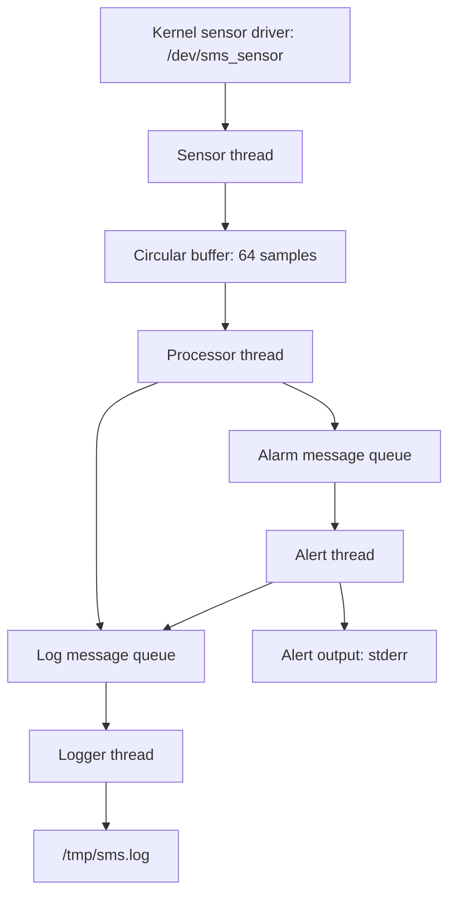

# Assignment 02 – Embedded Linux Sensor Monitoring System

**Project:** Embedded Linux – Assignment 02  
**Course:** LOS201, FPT University  
**Implementation contributor:** Trần Thiên Phúc – SE203798  
**Development host:** Ubuntu Linux, x86_64  
**Target architecture:** ARMv7-A (Cortex-A9)  
**Emulator:** QEMU (`vexpress-a9`)  
**Linux kernel:** Assignment-specific Linux 5.15 build  
**Programming language:** C11

---

## 1. Project Overview

This project implements a Sensor Monitoring System using a simulated Linux sensor driver and a multithreaded userspace application. The application collects temperature and humidity samples, calculates rolling averages, generates alerts, and writes timestamped records to a log file.

The implementation demonstrates character-device access, POSIX threads, mutexes and condition variables, a circular buffer, POSIX message queues, IOCTL configuration, graceful shutdown, memory analysis, debugging, profiling, and scheduling-jitter measurements.

Embedded execution is tested on QEMU ARM. A separate host-side source variant supports native Ubuntu analysis with mock sensor input. Measurements from these environments are identified separately below.

---

## 2. System Architecture

The system consists of a kernel sensor driver and four userspace worker threads.



### Thread Responsibilities

| Thread | Description |
|---|---|
| Sensor | Configure the driver interval, read CSV samples periodically, measure wake-up jitter, and push samples into the buffer |
| Processor | Consume samples, calculate rolling averages over up to 10 samples, and produce data records and alarms |
| Alert | Receive alarms, print their type/value/threshold, count each alarm type, and forward records to the logger |
| Logger | Write timestamped records, flush periodically, and rotate the log file |

The circular buffer uses a mutex and a condition variable. The processor waits for available samples rather than polling an empty buffer. Message-queue operations occur after buffer access releases its mutex, avoiding a nested buffer-lock/message-queue dependency in the normal data path.

---

## 3. Project Structure

Paths below are relative to this `assignment02/` directory.

| Location | Contents |
|---|---|
| [app/](app/) | Embedded application sources, headers, Makefile, prebuilt ARM `sms_app`, and native `sms_app_x86` |
| [driver/](driver/) | `sms_sensor_driver.c`, shared IOCTL header, Makefile, and ARM `sms_sensor_driver.ko` |
| [host_test/](host_test/) | Separate mock-sensor source variant used for native execution and analysis |
| [configs/kernel.config](configs/kernel.config) | Saved assignment kernel configuration |
| [rootfs/](rootfs/) | Selected initialization files from the existing BusyBox environment |
| [logs/](logs/) | Runtime, debugging, memory, profiling, and jitter evidence |
| [output/initramfs_asgn2.cpio.gz](output/initramfs_asgn2.cpio.gz) | Packaged BusyBox environment with the ARM application and driver in `/opt/student_sms/` |

The full kernel source tree, `zImage`, and DTB are maintained separately. The commands below use `$HOME/LOS201/asgn02/kernel` as the local assignment kernel build directory; adjust it to match your workspace.

The packaged image contains `/opt/student_sms/sms_app` and `/opt/student_sms/sms_sensor_driver.ko`. The selected `rootfs/` files alone are not a complete reconstruction of that image.

---

## 4. Task 1 – Sensor Monitoring System

### Objective

Develop a four-thread monitoring application that communicates with the simulated temperature/humidity sensor driver.

### Implementation

| Setting | Implementation |
|---|---|
| Device | `/dev/sms_sensor` |
| Read format | `timestamp_ms,temperature,humidity` |
| Circular-buffer capacity | 64 samples, allocated as part of one heap buffer object |
| Default application sampling interval | 500 ms |
| Default run duration | 60 seconds |
| Rolling-average window | Up to 10 samples |
| Alarm queue | `/sms_student_alarm` |
| Log queue | `/sms_student_log` |
| Log file | `/tmp/sms.log` |
| Log rotation | At approximately 1 MiB; previous file becomes `/tmp/sms.log.1` |
| Periodic flush | Approximately every 5 seconds, with a final flush during shutdown |

The simulated driver generates temperature values in the 15–45 °C range and humidity values in the 30–90% range.

### Alert Conditions

| Type | Default trigger |
|---|---|
| `TEMP_HIGH` | Temperature > 40 °C |
| `HUMID_HIGH` | Humidity > 80% |
| `TEMP_SPIKE` | Absolute temperature change between consecutive samples > 5 °C |

Temperature and humidity thresholds are configurable through command-line options. Alerts are evaluated from individual readings; rolling averages are included in data log records.

### Graceful Shutdown

Normal duration expiry, SIGINT, and SIGTERM initiate shutdown. The signal handler sets a stop flag. The main thread stops and joins the sensor, closes the buffer so the processor can finish, then stops and joins the alert and logger threads. Pending queue records can be consumed before the receivers terminate. Cleanup closes/unlinks message queues, destroys buffer synchronization objects, and frees the buffer.

The application prints counters and `Shutdown complete` after a successful run.

---

## 5. Task 2 – IOCTL and Memory Management

### Objective

Configure the sensor sampling interval, inspect driver statistics, and examine userspace memory usage and cleanup.

### IOCTL and Driver Statistics

| Interface | Function |
|---|---|
| `SMS_SET_INTERVAL` | Set the driver's minimum read interval using an unsigned 32-bit millisecond value |
| `/proc/sms_stats` | Read driver statistics such as read count, last sample timestamp, uptime, and minimum interval |

The driver starts with a 100 ms minimum interval. The application sets it to match its requested interval. The supported interface does not include the configuration-range or reset-statistics IOCTL commands described in some other implementations.

The sensor thread handles transient `EAGAIN`/`EINTR` conditions and empty reads, validates CSV input, and closes its file descriptor on exit.

### Memory Inspection

The complete guest transcript [qemu_memory_20261019_232410.txt](logs/qemu_memory_20261019_232410.txt) records a 60-second run at a 500 ms application interval, including memory readings at approximately 5, 30, and 55 seconds.

| Observation time | VmSize | VmRSS |
|---|---:|---:|
| Approximately 5 s | 34,572 kB | 4 kB |
| Approximately 30 s | 34,572 kB | 4 kB |
| Approximately 55 s | 34,572 kB | 4 kB |

These are the values reported by the recorded guest `/proc` observations. They remain unchanged at the three checkpoints; that observation alone is not a complete proof that all memory behavior is leak-free.

The same transcript records driver `read_count` increasing from 0 to 117. The separate `proc_sms_stats_before.txt` and `proc_sms_stats_after.txt` files belong to a shorter test and should not be interpreted as that 60-second run.

The saved [sms_maps.txt](logs/sms_maps.txt) supports inspection of executable/read-only mappings, writable data, heap, anonymous thread-related mappings, and the main stack. The ARM executable is statically linked, so a shared-library layout should not be assumed for that guest process.

---

## 6. Task 3 – Debugging and Performance Profiling

### Objective

Inspect thread/buffer behavior, check native memory cleanup, and analyze system calls and sampled execution paths.

### 6.1 GDB

The recorded [gdb_processor_final.txt](logs/gdb_processor_final.txt) session inspects buffer access in the processor-thread context, buffer indices/count, the thread list, and thread backtraces. The application has four worker threads in addition to the main thread.

Function names in the implementation include `sms_sensor_thread`, `sms_processor_thread`, `sms_alert_thread`, and `sms_logger_thread`.

### 6.2 Valgrind

The [valgrind_sms.txt](logs/valgrind_sms.txt) log records a native host test using mock sensor input:

```text
in use at exit: 0 bytes in 0 blocks
total heap usage: 17 allocs, 17 frees, 15,746 bytes allocated
ERROR SUMMARY: 0 errors from 0 contexts (suppressed: 0 from 0)
```

This result applies to that recorded host-side test, not to a Valgrind run inside the ARM guest.

### 6.3 strace

The [strace_sms.txt](logs/strace_sms.txt) summary records 1,347 system calls. The five most frequent calls, ranked by call count, are:

| System call | Calls | Relationship to the application |
|---|---:|---|
| `mq_timedreceive` | 427 | Waiting for alarm and log messages, including timed waits |
| `futex` | 193 | Thread synchronization and wake-ups |
| `lseek` | 181 | Repositioning seekable input or output streams |
| `mq_timedsend` | 180 | Sending alarm and log records |
| `write` | 121 | Writing output and log records |

`clock_nanosleep` has the largest reported time share in this trace. Time spent waiting or sleeping must not be interpreted directly as CPU utilization.

### 6.4 perf

The saved [perf_sms.txt](logs/perf_sms.txt) contains a native host call-graph report with 108 samples of `cpu_atom/cycles/P`. It includes sensor-thread work, buffer synchronization, and condition-variable/futex wake-up paths.

The report's `Children` percentages include callees; they are not exclusive per-function execution percentages. A possible optimization to evaluate is signaling the buffer condition only when transitioning from empty to nonempty, if the producer/consumer design preserves correctness. No performance improvement from this proposed change is claimed here.

---

## 7. Task 4 – Real-Time Scheduling

### Objective

Compare periodic sensor-thread wake-up jitter under normal and real-time scheduling.

### Scheduling Policy

| Mode | Sensor thread | Other worker threads |
|---|---|---|
| Default | `SCHED_OTHER` | Normal inherited scheduling |
| With `-r` | Requests `SCHED_FIFO`, priority 50 | Normal inherited scheduling |

The `-r` mode also attempts `mlockall(MCL_CURRENT | MCL_FUTURE)`. Failures are reported; the printed jitter policy indicates whether the sensor's FIFO request succeeded.

The sensor uses `CLOCK_MONOTONIC` and `clock_nanosleep` with `TIMER_ABSTIME`. Jitter is measured as the absolute difference between the actual wake-up time and its planned deadline, in microseconds.

### Recorded QEMU Results

The paired runs in [jitter_report.txt](logs/jitter_report.txt) use a 100 ms interval and a 105-second duration per policy.

| Policy | Samples | Min (µs) | Average (µs) | Max (µs) | P99 (µs) |
|---|---:|---:|---:|---:|---:|
| `SCHED_OTHER` | 1,050 | 233 | 609.55 | 1,359 | 974 |
| `SCHED_FIFO` | 1,050 | 359 | 626.44 | 1,133 | 971 |

| Policy | [0,100) µs | [100,500) µs | [500,1000) µs | [1000,+∞) µs |
|---|---:|---:|---:|---:|
| `SCHED_OTHER` | 0 | 171 | 870 | 9 |
| `SCHED_FIFO` | 0 | 113 | 929 | 8 |

P99 improves by approximately `(974 - 971) / 974 × 100 = 0.31%`. Maximum observed jitter decreases, while average jitter increases slightly. These measurements do not support a claim of a large overall timing improvement.

For context, the measured P99 values are about 0.2% of a 500 ms sampling period, but acceptability depends on a specified deadline and tolerance. QEMU results do not guarantee physical-hardware worst-case timing. PREEMPT_RT, CPU isolation, and IRQ-affinity tuning are possible follow-up experiments on a suitable target.

---

## 8. Build Instructions

### Requirements

Use Ubuntu with GCC, Make, the `arm-linux-gnueabihf-` cross-compiler, QEMU System ARM, CPIO, and Gzip. Rebuilding the driver requires the configured matching assignment kernel build. GDB, Valgrind, strace, and perf support the analysis tasks.

Run the following commands from `assignment02/` in your clone:

```bash
cd "$HOME/LOS201-Embedded-Linux-Group/assignment02"
```

### 8.1 Build Kernel Module

```bash
make -C driver arm KDIR="$HOME/LOS201/asgn02/kernel"
file driver/sms_sensor_driver.ko
```

The module must match the guest kernel build, not merely its major/minor version.

### 8.2 Compile ARM Application

```bash
make -C app arm
file app/build/sms_app_arm
```

Build the native architecture version separately:

```bash
make -C app host
file app/build/sms_app_x86
```

The native build of `app/` still uses `/dev/sms_sensor` and the sensor IOCTL. It does not automatically become a mock-sensor test. The `host_test/` directory contains the separate variant used for the recorded host analysis.

### 8.3 Copy Files into RootFS

The supplied initramfs already contains the ARM application and driver. When rebuilding it, use a complete BusyBox rootfs staging directory, not the selected `rootfs/` files alone. Set `SMS_ROOTFS` to that directory, then install:

```bash
: "${SMS_ROOTFS:?Set SMS_ROOTFS to a complete rootfs staging directory}"
install -d "$SMS_ROOTFS/opt/student_sms"
install -m 755 app/build/sms_app_arm "$SMS_ROOTFS/opt/student_sms/sms_app"
install -m 644 driver/sms_sensor_driver.ko "$SMS_ROOTFS/opt/student_sms/sms_sensor_driver.ko"
```

### 8.4 Rebuild Initramfs

From `assignment02/`, with `SMS_ROOTFS` set to the complete staging directory:

```bash
mkdir -p output
SMS_IMAGE="$PWD/output/initramfs_asgn2.cpio.gz"
(
  cd "${SMS_ROOTFS:?Set SMS_ROOTFS to a complete rootfs staging directory}" || exit
  set -o pipefail
  find . \( -path './opt/reference' -o -name '*.bak.*' \) -prune -o -print0 |
    cpio --null -o --format=newc --owner=0:0 |
    gzip -9 > "$SMS_IMAGE"
)
```

This Bash packaging command excludes reference binaries and development backups. Keep the generated image outside its staging directory.

---

## 9. Running the Application on QEMU

### 9.1 Start QEMU

From `assignment02/` on the Ubuntu host:

```bash
ASGN02_KERNEL="$HOME/LOS201/asgn02/kernel"
qemu-system-arm -M vexpress-a9 -m 256M -nographic \
  -kernel "$ASGN02_KERNEL/arch/arm/boot/zImage" \
  -dtb "$ASGN02_KERNEL/arch/arm/boot/dts/vexpress-v2p-ca9.dtb" \
  -initrd output/initramfs_asgn2.cpio.gz \
  -append "console=ttyAMA0"
```

Press Enter if prompted to activate the console. The reused base image retains LAB02 startup messages; the Assignment 02 sensor module is loaded separately below.

### 9.2 Load Sensor Driver

Inside QEMU:

```sh
insmod /opt/student_sms/sms_sensor_driver.ko
ls -l /dev/sms_sensor /proc/sms_stats
cat /proc/sms_stats
```

### 9.3 Mount POSIX Message Queue Filesystem

The application requires kernel POSIX message-queue support. Mounting the filesystem makes queues visible for inspection; it is not required merely to use `mq_open`:

```sh
mkdir -p /dev/mqueue
mount -t mqueue none /dev/mqueue
```

Skip the mount command if it is already mounted.

### 9.4 Run Sensor Monitoring System

```sh
/opt/student_sms/sms_app -i 500 -d 60 -v
```

| Option | Meaning | Default |
|---|---|---|
| `-i` | Sampling interval in milliseconds; accepted range 100–5,000 | 500 |
| `-t` | Temperature alert threshold in °C | 40 |
| `-h` | Humidity alert threshold in percent; this is not a help flag | 80 |
| `-d` | Duration in seconds; 0 runs until interrupted | 60 |
| `-v` | Print sensor samples | Off |
| `-r` | Request sensor FIFO scheduling and memory locking | Off |

To reproduce the scheduling comparison, run the following sequentially inside QEMU:

```sh
/opt/student_sms/sms_app -i 100 -d 105
/opt/student_sms/sms_app -i 100 -d 105 -r
```

### 9.5 Stop the Application

The program stops automatically after its requested duration. For an indefinite run (`-d 0`), press Ctrl+C. Successful shutdown prints sample/drop/error counters, alarm counts, jitter statistics, and:

```text
Shutdown complete
```

Inspect the log inside QEMU:

```sh
tail -n 20 /tmp/sms.log
```

### 9.6 Verify Message Queue Cleanup

If the mqueue filesystem is mounted:

```sh
ls -la /dev/mqueue
```

After normal cleanup, the application's `/sms_student_alarm` and `/sms_student_log` queues should no longer be present.

### 9.7 Exit QEMU

Press Ctrl+A, release both keys, then press X.

---

## 10. Testing Summary

| Check | Recorded evidence / result |
|---|---|
| Main application build | ARM and native builds completed without compiler warnings in the packaging check |
| Packaged-image smoke test | QEMU boot, module load, 10-second run: 19 samples read/processed, zero buffer/queue drops and read errors, all three alarm types, normal shutdown |
| Longer guest execution | [memory_run.log](logs/memory_run.log) and [full QEMU transcript](logs/qemu_memory_20261019_232410.txt) |
| Memory checkpoints and procfs statistics | [Full QEMU transcript](logs/qemu_memory_20261019_232410.txt) and [sms_maps.txt](logs/sms_maps.txt) |
| GDB buffer/thread inspection | [gdb_processor_final.txt](logs/gdb_processor_final.txt) |
| Native Valgrind test | [valgrind_sms.txt](logs/valgrind_sms.txt): zero bytes remaining and zero reported errors |
| Native syscall summary | [strace_sms.txt](logs/strace_sms.txt) |
| Native sampled call graph | [perf_sms.txt](logs/perf_sms.txt) |
| Paired guest scheduling runs | [jitter_report.txt](logs/jitter_report.txt), [OTHER run](logs/jitter_other_1000.log), [FIFO run](logs/jitter_fifo_1000.log) |

The short packaged-image smoke test is separate from the longer recorded timing and memory experiments. Historical logs reflect the tested source variants at the time of collection; they should not all be described as fresh measurements of the packaged binary.

---

## 11. Important Notes

1. Embedded experiments use QEMU ARM, not a physical development board.
2. Host mock-input measurements and ARM driver measurements serve different purposes and should not be combined as one execution.
3. Use the matching assignment kernel and module. The saved kernel configuration is included; kernel images and the source tree are maintained separately.
4. The supplied ARM binary is `app/sms_app`; the application inside the initramfs is `/opt/student_sms/sms_app`.
5. The x86_64 binary `app/sms_app_x86` still requires a compatible sensor device. Use the separate host-test setup for mock-input analysis.
6. The `/tmp` log exists in guest RAM and is lost when the guest exits unless exported.
7. Running multiple application instances concurrently is unsupported because the application uses fixed message-queue names.
8. Report preparation, demonstration video, and final submission packaging are separate group responsibilities. Their completion is not implied by the source/log evidence listed here.

---

## 12. Project Status

| Task | Status |
|---|---|
| Task 1 – Sensor Monitoring System | Practical implementation and execution evidence provided |
| Task 2 – Memory and Driver Integration | Practical implementation and recorded memory/driver evidence provided |
| Task 3 – Debugging and Profiling | GDB, native Valgrind, strace, and perf evidence provided |
| Task 4 – Real-Time Scheduling and Jitter | Implementation and paired QEMU measurements provided |
| Task 5 – Report and Demonstration | Managed separately by the group |

The practical implementation and recorded technical evidence for Tasks 1–4 are organized in this directory. Assessment of the complete submission also depends on the separately prepared report, demonstration, and lecturer's submission requirements.
