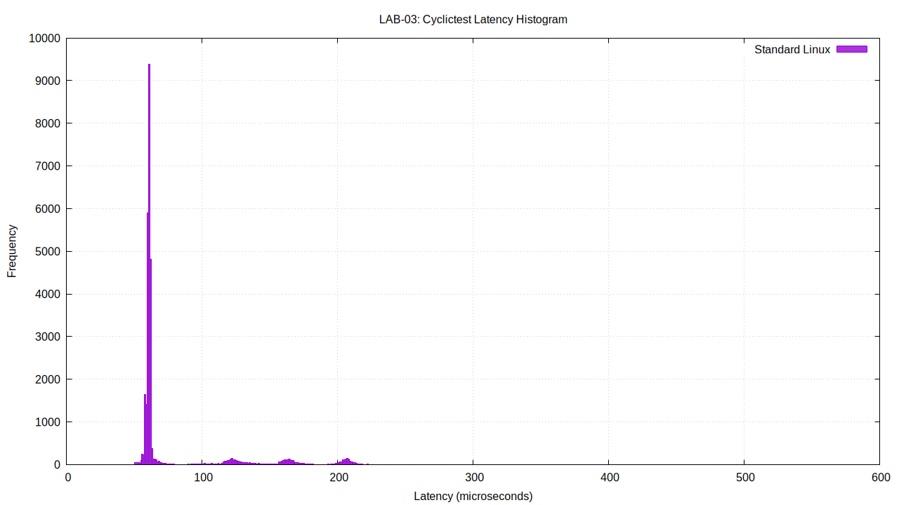

# LAB03 – Embedded Linux Debugging and Performance Evaluation

**Course:** LOS201 – Embedded Linux Systems  
**Student:** Dinh Quang Ngoc  
**Student ID:** SE201573  
**Operating System:** Ubuntu Linux (x86_64)  
**Target Platform:** ARM Linux running under QEMU  
**Programming Language:** C

---

## 1. Project Introduction

This laboratory explores the debugging, memory management, performance profiling, and real-time behavior of applications running in an Embedded Linux environment.

The project combines an Ubuntu development machine with an emulated ARM Linux target. Applications are written in C, compiled for the appropriate architecture, and examined using standard Linux development and diagnostic utilities.

The laboratory is divided into four experiments:

| Section | Experiment | Main Tools |
|---|---|---|
| Part A | Remote Application Debugging | GDB Multiarch, GDB Server, QEMU |
| Part B | Dynamic Memory Investigation | Valgrind, Linux `/proc` |
| Part C | Application Performance Evaluation | strace, perf |
| Part D | Scheduling Latency Measurement | cyclictest |

The primary goal is not only to identify software defects but also to understand how Linux tools expose application behavior at different levels, from individual variables and memory allocations to CPU execution and kernel scheduling.

## 2. Development Environment

### 2.1. Host System

The host computer runs Ubuntu Linux on an x86_64 processor.

It is responsible for:

- Editing and compiling C source files.
- Cross-compiling applications for the ARM target.
- Controlling debugging sessions.
- Running memory analysis and profiling utilities.
- Recording experiment results.
- Generating performance logs and latency visualizations.

The main development tools are GCC, GDB Multiarch, Valgrind, strace, perf, QEMU, and cyclictest.

### 2.2. ARM Target

The target environment is an ARM Linux system emulated using QEMU.

It provides a controlled environment for executing ARM binaries and performing remote debugging without requiring a physical ARM development board.

The target uses a Linux kernel and an initramfs-based root filesystem. The prepared filesystem is stored in:

`output/initramfs_lab3.cpio.gz`

The filesystem contains the necessary runtime components for the ARM debugging experiment.

### 2.3. Host–Target Workflow

```text
                  Ubuntu Host (x86_64)
                           |
                C Application Source
                           |
                +----------+----------+
                |                     |
          Native Compiler       ARM Cross-Compiler
                |                     |
          x86_64 Programs         ARM Programs
                |                     |
       +--------+--------+            |
       |        |        |            v
    Valgrind  strace    perf       ARM initramfs
                                     |
                                     v
                                 QEMU ARM
                                     |
                                     v
                                GDB Server
                                     |
                                     v
                            GDB Multiarch
                              on Ubuntu
```

Real-time latency measurements are performed on the Ubuntu host rather than relying on timing behavior inside the emulated environment.

This separation is important because QEMU introduces additional scheduling and emulation overhead that can affect timing measurements.

---

## 3. Repository Organization

The project files are organized into separate directories for source code, experimental evidence, generated system images, and documentation.

```text
lab03/
|
|-- README.md
|
|-- apps/
|   |-- buggy_app.c
|   |-- buggy_app
|   |-- leaky_app.c
|   |-- leaky_app
|   |-- leaky_app_fixed.c
|   |-- leaky_app_fixed
|   `-- perf_target.c
|
|-- logs/
|   |-- gdb_session.txt
|   |-- valgrind_report.txt
|   |-- valgrind_fixed.txt
|   |-- strace_summary.txt
|   |-- perf_stat.txt
|   |-- perf_report.txt
|   |-- hist_standard.txt
|   `-- latency_histogram.png
|
|-- output/
|   `-- initramfs_lab3.cpio.gz
|
`-- baocao/
    `-- SE201573_Lab03_BaoCao.pdf
```

### 3.1. Application Files

The `apps/` directory contains the C programs and executables used in the experiments.

| File | Description |
|---|---|
| `buggy_app.c` | Source code for the debugging exercise |
| `buggy_app` | ARM executable used in the debugging environment |
| `leaky_app.c` | Original application used for memory analysis |
| `leaky_app` | Original x86_64 executable |
| `leaky_app_fixed.c` | Corrected memory management implementation |
| `leaky_app_fixed` | Corrected x86_64 executable |
| `perf_target.c` | Application used for performance measurements |

### 3.2. Experimental Logs

The `logs/` directory contains the recorded outputs of the diagnostic tools.

These files allow the results to be reviewed without repeating every experiment.

The logs provide evidence for:

- GDB variable inspection and debugging.
- Memory leak detection and verification.
- System-call statistics.
- CPU performance counters and profiling.
- Scheduling latency measurements.

### 3.3. Generated Files

The `output/` directory stores the ARM initramfs image.

The `baocao/` directory is reserved for the final laboratory report in PDF format.

---

## 4. Part A – Remote Debugging with GDB

### 4.1. Objective

The first experiment investigates software defects in a C application running on an emulated ARM Linux target.

GDB is used to inspect program execution, evaluate variable values, and identify the source of incorrect behavior.

The exercise focuses on three common programming errors:

1. Array out-of-bounds access.
2. Use-after-free.
3. Integer overflow.

### 4.2. Debugging Approach

The application is compiled for ARM and executed inside QEMU.

GDB Multiarch runs on the Ubuntu host and connects to the debugging environment of the ARM target.

The investigation uses debugging commands such as:

```gdb
break main
continue
next
step
print variable_name
backtrace
info registers
```

These commands help identify where incorrect program behavior originates.

### 4.3. Bug 1 – Array Out-of-Bounds

The original program uses a loop condition that permits an array index to reach the array length.

For an array containing five elements, valid indices range from `0` to `4`.

However, the debugging session reaches:

```text
i = 5
len = 5
sum = 150
```

At this point, accessing `data[5]` goes beyond the valid array boundary.

**Root cause:** An incorrect loop termination condition.

**Correction:** Replace the condition `i <= len` with `i < len`.

This prevents the loop from accessing an element outside the array.

### 4.4. Bug 2 – Use-After-Free

The second issue involves a dynamically allocated character buffer.

The original implementation releases the allocated memory before returning a pointer to it.

After `free()` executes, the pointer no longer refers to a valid allocated object, even though its numerical address may remain unchanged.

The debugger demonstrates that the buffer content is no longer reliable after deallocation.

**Root cause:** Returning and subsequently using a pointer to released memory.

**Correction:** Preserve the allocated buffer until the caller has finished using it, then release it at the appropriate location.

This establishes clear ownership of the allocated memory.

### 4.5. Bug 3 – Integer Overflow

The third defect occurs during multiplication using a 32-bit signed integer.

The intended calculation is:

```text
100000 × 100000 = 10000000000
```

However, the original program produces:

```text
1410065408
```

The expected result exceeds the range of a signed 32-bit integer.

**Root cause:** An insufficient integer type for the calculation.

**Correction:** Use a wider integer type, such as `long long`, and apply the corresponding output format.

### 4.6. Debugging Results

| Test | Original Behavior | Corrected Behavior |
|---|---|---|
| Array calculation | Incorrect result caused by invalid memory access | `Sum = 150` |
| String handling | Invalid or corrupted message | `Hello Embedded Linux` |
| Integer multiplication | `1410065408` | `10000000000` |

The experiment demonstrates that incorrect output does not always result in an immediate application crash.

Some memory-related errors produce unpredictable behavior while allowing the program to continue running.

**Evidence:** `logs/gdb_session.txt`

---

## 5. Part B – Memory Analysis with Valgrind

### 5.1. Objective

This experiment examines how incorrect dynamic memory management affects a Linux application.

Valgrind Memcheck is used to detect allocations that remain unreleased when the program terminates.

The application is analyzed before and after correcting the memory management code.

### 5.2. Initial Memory Inspection

The original executable can be examined using:

```bash
valgrind --leak-check=full \
  --show-leak-kinds=all \
  ./apps/leaky_app
```

Valgrind reports the following heap statistics:

| Metric | Original Application |
|---|---:|
| Total heap allocations | 3 |
| Total heap frees | 2 |
| Total allocated bytes | 4,216 |
| Memory remaining at exit | 100 bytes |
| Definitely lost memory | 100 bytes |
| Indirectly lost memory | 0 bytes |
| Reported error contexts | 3 |

The report identifies a 100-byte allocation that was not released before program termination.

The allocation trace points to a `malloc()` operation in `leaky_app.c`.

This indicates that the application loses ownership of an allocated memory block without releasing it.

### 5.3. Memory Management Correction

The corrected source file is stored as:

`apps/leaky_app_fixed.c`

The correction ensures that allocated memory is released when it is no longer required.

The modified executable is verified using:

```bash
valgrind --leak-check=full \
  --show-leak-kinds=all \
  ./apps/leaky_app_fixed
```

### 5.4. Before-and-After Comparison

| Measurement | Before Correction | After Correction |
|---|---:|---:|
| Allocations | 3 | 3 |
| Frees | 2 | 3 |
| Memory remaining at exit | 100 bytes | 0 bytes |
| Definitely lost | 100 bytes | 0 bytes |
| Valgrind errors | 3 | 0 |

The corrected program produces:

```text
All heap blocks were freed -- no leaks are possible

ERROR SUMMARY: 0 errors from 0 contexts
```

### 5.5. Technical Interpretation

Memory leaks occur when an application allocates memory but fails to release it before the allocation becomes unreachable.

For a short-lived application, a small leak may not immediately affect execution.

However, repeated leaks in long-running embedded applications can gradually reduce available memory and eventually affect reliability.

Valgrind is useful because it reports not only the amount of leaked memory but also the allocation location.

The Linux `/proc/<PID>/status` interface can additionally be used to observe process memory statistics such as `VmRSS` and `VmSize`.

However, resident memory measurements alone cannot prove whether an application has a memory leak.

**Evidence:**

- `logs/valgrind_report.txt`
- `logs/valgrind_fixed.txt`

---

## 6. Part C – Performance Profiling

### 6.1. Objective

This experiment evaluates application performance from two perspectives:

- Interaction between the application and the Linux kernel.
- CPU activity and computational hotspots.

Two diagnostic tools are used:

**strace** records system-call activity.

**perf** measures CPU-related events and collects profiling samples.

### 6.2. System-Call Analysis

The system-call summary is generated using:

```bash
strace -c ./apps/perf_target
```

The `-c` option produces a statistical summary of system calls, including execution time, call count, and errors.

### 6.3. Observed System Calls

The recorded results include:

| System Call | Calls | Percentage of Traced Syscall Time |
|---|---:|---:|
| `execve` | 1 | 65.99% |
| `mmap` | 8 | 11.13% |
| `mprotect` | 3 | 4.15% |
| `write` | 4 | 3.95% |
| `brk` | 3 | 2.43% |

The complete trace contains:

```text
Total system calls: 37
Total measured syscall time: 0.000988 seconds
```

The highest percentage belongs to `execve`, which is associated with starting the application.

Memory-related calls such as `mmap`, `mprotect`, and `brk` also appear in the trace.

The `write` calls represent output operations performed by the application.

These percentages describe the time observed by strace for system calls, not the percentage of the application's total CPU execution time.

### 6.4. CPU Performance Counters

CPU performance statistics are collected using perf.

The recorded measurements include:

| Performance Metric | Recorded Value |
|---|---:|
| CPU cycles | 400,663,324 |
| Instructions | 2,044,198,217 |
| Branches | 102,412,690 |
| Branch misses | 4,061 |
| Context switches | 3 |
| CPU migrations | 1 |
| Page faults | 63 |
| Elapsed time | 0.0952 seconds |

The measured instructions-per-cycle ratio is approximately:

**IPC = 5.1**

IPC describes the average number of retired instructions per measured CPU cycle.

Its interpretation depends on the processor architecture, workload, and performance-counter configuration.

### 6.5. CPU Hotspot Investigation

The profiling report indicates that approximately 99.68% of the collected CPU samples are associated with the application's `main` function.

This suggests that the main computational workload dominates the sampled execution profile.

The measurements also show that user-space execution time is much greater than kernel-space execution time.

Therefore, the observed workload is primarily CPU-oriented rather than dominated by system-call overhead.

### 6.6. Potential Improvements

Possible optimization directions include:

- Reducing unnecessary repeated calculations.
- Moving reusable computations outside frequently executed loops.
- Improving data access patterns.
- Avoiding redundant operations.
- Repeating measurements after each optimization to verify the actual effect.

Any optimization should be evaluated using comparable workloads and execution conditions.

**Evidence:**

- `logs/strace_summary.txt`
- `logs/perf_stat.txt`
- `logs/perf_report.txt`

---

## 7. Part D – Real-Time Scheduling Latency

### 7.1. Objective

The final experiment measures Linux scheduling latency using cyclictest.

Scheduling latency is the delay between the time a thread is expected to become runnable and the time it actually resumes execution.

This measurement is important for embedded systems that must respond to events within a specified deadline.

### 7.2. Measurement Environment

The experiment is performed on the Ubuntu host.

Using the physical host avoids interpreting QEMU scheduling overhead as the actual scheduling behavior of the guest Linux kernel.

The test records minimum, average, and maximum latency.

### 7.3. Experimental Results

| Measurement | Latency |
|---|---:|
| Minimum | 10 µs |
| Average | 76 µs |
| Maximum | 550 µs |

The recorded maximum latency is significantly greater than the average.

This difference illustrates why average latency alone is insufficient for evaluating real-time behavior.

### 7.4. Latency Distribution

The experiment also generates a histogram showing the distribution of recorded scheduling delays.



The histogram helps distinguish frequently observed latency values from less frequent high-latency events.

The original measurement data is stored in:

`logs/hist_standard.txt`

### 7.5. Deadline Evaluation

Consider a robotic control application requiring a response within 500 µs.

The measured maximum latency is:

```text
Observed maximum: 550 µs
Required deadline: 500 µs
```

The maximum observed value exceeds the required deadline by 50 µs.

Therefore, the tested standard Linux configuration did not consistently satisfy the hypothetical deadline during this measurement.

### 7.6. PREEMPT_RT Considerations

PREEMPT_RT is a Linux real-time kernel approach designed to improve scheduling responsiveness and reduce latency variability.

It introduces more preemptible kernel execution paths and uses mechanisms such as threaded interrupt handling.

For applications with strict timing requirements, a properly configured PREEMPT_RT kernel may provide more predictable response times than a general-purpose configuration.

However, this laboratory does not establish a measured latency result for PREEMPT_RT.

Its suitability would need to be verified through additional experiments on the intended hardware and under representative system loads.

**Evidence:**

- `logs/hist_standard.txt`
- `logs/latency_histogram.png`

---

## 8. Reproducing the Experiments

The following examples assume that the current working directory is the root of `lab03/`.

### 8.1. Verify the Application Files

```bash
ls -lh apps/
```

### 8.2. Run the Original Memory Test

```bash
valgrind --leak-check=full \
  --show-leak-kinds=all \
  ./apps/leaky_app
```

### 8.3. Verify the Corrected Application

```bash
valgrind --leak-check=full \
  --show-leak-kinds=all \
  ./apps/leaky_app_fixed
```

### 8.4. Inspect System Calls

Compile the performance target if the executable is not present:

```bash
gcc -O0 -g apps/perf_target.c -o apps/perf_target -lm
```

Run the system-call analysis:

```bash
strace -c ./apps/perf_target
```

### 8.5. Collect CPU Statistics

```bash
perf stat ./apps/perf_target
```

### 8.6. Record CPU Profiling Samples

```bash
perf record -g -- ./apps/perf_target
```

Inspect the report:

```bash
perf report
```

### 8.7. Inspect Saved Experimental Evidence

```bash
cat logs/gdb_session.txt
cat logs/valgrind_report.txt
cat logs/valgrind_fixed.txt
cat logs/strace_summary.txt
cat logs/perf_stat.txt
cat logs/perf_report.txt
```

The saved logs are the reference results for this laboratory. Repeated measurements may differ because of changes in system load, CPU frequency, kernel configuration, and execution environment.

---

## 9. Technical Challenges and Lessons Learned

### 9.1. Cross-Architecture Debugging

Debugging an ARM executable from an x86_64 host requires compatible debugging tools and a correctly configured connection to the target.

The host and target must use the appropriate executable format and debugging symbols.

This experiment demonstrates how remote debugging can be performed without a physical ARM board.

### 9.2. Memory Ownership

The memory analysis experiment highlights the importance of deciding which function is responsible for releasing dynamically allocated memory.

Incorrect ownership can lead to memory leaks or invalid pointer access.

The corrected implementation demonstrates the need to pair successful allocations with appropriate deallocations.

### 9.3. Understanding Profiling Results

Different profiling tools answer different questions.

Valgrind identifies memory management problems.

strace explains how an application interacts with the kernel.

perf reveals CPU events and sampled execution hotspots.

Using these tools together provides a broader understanding of application behavior.

### 9.4. Interpreting Scheduling Latency

A low average latency does not guarantee that every deadline will be satisfied.

Occasional high-latency events are especially important in applications such as industrial controllers, robotics, and time-sensitive data acquisition systems.

Real-time suitability must therefore be evaluated using worst-case observations, realistic workloads, and sufficiently extensive testing.

---

## 10. Experiment Evidence

The following files document the completed work.

| Experiment | Evidence |
|---|---|
| Remote Debugging | `logs/gdb_session.txt` |
| Memory Leak Detection | `logs/valgrind_report.txt` |
| Memory Leak Correction | `logs/valgrind_fixed.txt` |
| System-Call Profiling | `logs/strace_summary.txt` |
| CPU Performance Statistics | `logs/perf_stat.txt` |
| CPU Hotspot Profiling | `logs/perf_report.txt` |
| Scheduling Latency | `logs/hist_standard.txt` |
| Latency Visualization | `logs/latency_histogram.png` |
| ARM Root Filesystem | `output/initramfs_lab3.cpio.gz` |

The evidence files preserve the original experimental observations and support the conclusions presented in the laboratory report.

---

## 11. Limitations

Several limitations should be considered when interpreting the results.

**ARM emulation:** QEMU does not reproduce every timing characteristic of physical ARM hardware.

**Memory measurements:** The Valgrind results verify the original and corrected host applications. A separate ARM process-memory comparison is not included in the current evidence.

**CPU profiling:** perf uses statistical sampling, so the measured overhead distribution may change between runs.

**Real-time analysis:** The available latency data represents a standard-kernel measurement. A direct experimental comparison with PREEMPT_RT has not been performed.

**Reproducibility:** Hardware specifications, kernel configuration, application compiler options, and background workloads can affect performance measurements.

These limitations should be taken into account when extending the laboratory or comparing results across different systems.

---

## 12. Final Summary

LAB03 provided practical experience with essential Linux debugging and performance analysis tools.

The completed experiments achieved the following results:

- Investigated and corrected three C programming errors through ARM remote debugging.
- Identified a 100-byte memory leak and verified its removal with Valgrind.
- Recorded and analyzed Linux system-call activity using strace.
- Collected CPU performance statistics and identified the primary sampled execution hotspot using perf.
- Measured scheduling latency with cyclictest and generated a latency histogram.
- Observed a maximum scheduling delay of 550 µs, exceeding a hypothetical 500 µs response deadline.

Together, these experiments demonstrate the importance of software correctness, responsible memory management, performance measurement, and scheduling predictability in Embedded Linux development.

---

**Prepared by:** Dinh Quang Ngoc  
**Student ID:** SE201573  
**Course:** LOS201 – Embedded Linux Systems  
**Laboratory:** LAB03 – Debugging and Performance Analysis
