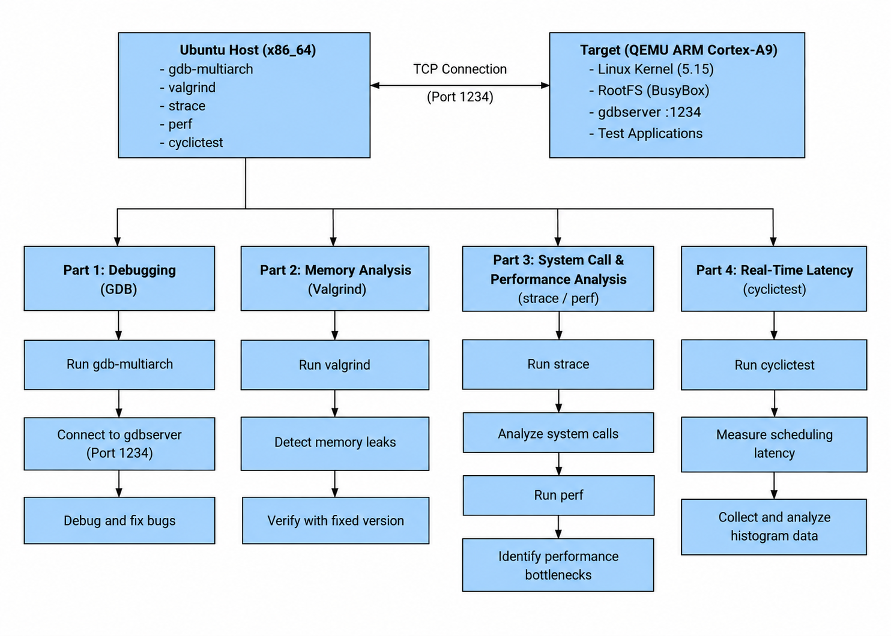
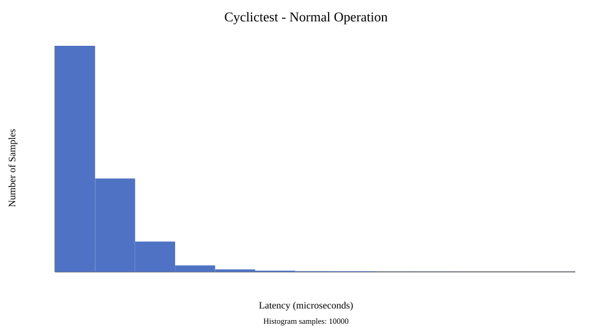
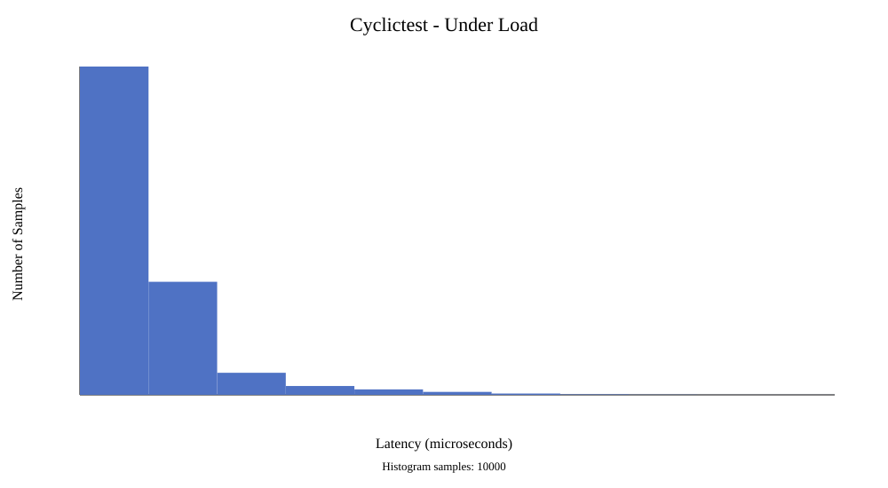

# LAB03 — Debugging and Performance Analysis

**Contributor:** Đinh Quang Ngọc 

**Course:** LOS201 — Embedded Linux Systems, FPT University  
**Platform:** Ubuntu Linux (x86-64) / ARM Cortex-A9 (QEMU)  
**Language:** C  
**Development Tools:** GDB Multiarch, Valgrind, strace, perf, cyclictest
## Overview

This lab explores debugging techniques and performance analysis for Embedded Linux applications. The experiments focus on identifying programming errors, detecting memory leaks, analyzing system calls, profiling CPU performance, and measuring real-time scheduling latency.

The lab consists of four main parts:

- **Part A:** Remote Debugging with GDB
- **Part B:** Memory Leak Detection with Valgrind
- **Part C:** System Call Tracing and CPU Profiling
- **Part D:** Real-Time Latency Analysis with cyclictest

The practical work and experimental evidence are documented in the [Lab 03 Report](report/SE201573_DinhQuangNgoc_Lab03_Report.pdf).

## Contents

- [Platform](#platform)
- [System Architecture](#system-architecture)
- [Repository Materials](#repository-materials)
- [Quick Start](#quick-start)
- [Lab Workflow](#lab-workflow)
- [Testing and Verification](#testing-and-verification)
- [Troubleshooting](#troubleshooting)
- [References](#references)

## Platform

| Component | Configuration |
|---|---|
| Development Host | Ubuntu Linux (x86-64) |
| Target Architecture | ARMv7-A |
| Target CPU | Cortex-A9 |
| QEMU Machine | `vexpress-a9` |
| Cross-Compiler | `arm-linux-gnueabihf-gcc` |
| Remote Debugger | GDB Multiarch / gdbserver |
| Memory Analyzer | Valgrind |
| Performance Tools | strace, perf |
| Latency Measurement | cyclictest |

## System Architecture




**Figure 1. LAB03 System Architecture**

The diagram illustrates the Ubuntu development host, the ARM Cortex-A9 target running under QEMU, and the remote debugging connection between GDB Multiarch and gdbserver.

The connection arrows represent debugging commands, execution control, and information exchanged between the host and target.


The development environment consists of an Ubuntu host and an ARM target emulated using QEMU.

GDB Multiarch connects to `gdbserver` on the ARM target for remote debugging. Valgrind, strace, perf, and cyclictest are used for memory, system-call, performance, and latency analysis on the Ubuntu host.

## Repository Materials

| Path | Description |
|---|---|
| `apps/` | C source code and executable programs |
| `logs/` | Debugging and performance analysis results |
| `output/` | ARM initramfs and generated artifacts |
| `report/` | Lab report and experimental evidence |
| `README.md` | Project documentation |

### Repository Structure

```text
lab03/
├── apps/
│   ├── buggy_app.c
│   ├── buggy_app
│   ├── leaky_app.c
│   ├── leaky_app_fixed.c
│   └── perf_target.c
├── logs/
│   ├── gdb_session.txt
│   ├── valgrind_report.txt
│   ├── valgrind_fixed.txt
│   ├── strace_summary.txt
│   ├── perf_stat.txt
│   ├── perf_report.txt
│   └── hist_standard.txt
├── output/
│   └── initramfs_lab3.cpio.gz
├── report/
│   └── SE201573_DinhQuangNgoc_Lab03_Report.pdf
└── README.md
```

*The directory layout shows the main project materials. Actual generated files may vary.*

## Quick Start

### 1. Install Required Tools

Run on the Ubuntu host:

```bash
sudo apt update
sudo apt install -y \
  build-essential \
  gcc-arm-linux-gnueabihf \
  gdb-multiarch \
  qemu-system-arm \
  valgrind \
  strace \
  linux-perf \
  rt-tests
```

Package availability may vary by Ubuntu version.

### 2. Build Applications

Compile the ARM debugging application:

```bash
arm-linux-gnueabihf-gcc \
  -g -O0 apps/buggy_app.c \
  -o apps/buggy_app
```

Compile the host-native memory analysis application:

```bash
gcc -g -O0 \
  apps/leaky_app.c \
  -o apps/leaky_app
```

Compile the profiling application:

```bash
gcc -g -O2 \
  apps/perf_target.c \
  -o apps/perf_target
```

## Lab Workflow

### Part A — GDB Remote Debugging

**Objective:** Identify and fix programming errors using GDB.


#### Remote Debugging Verification

The remote debugging experiment was successfully verified using GDB Multiarch on the Ubuntu host and gdbserver running inside the QEMU ARM guest.

The ARM target was emulated using the `vexpress-a9` machine with an ARM Cortex-A9 processor.

QEMU user-mode networking was configured with TCP port forwarding from `127.0.0.1:1234` on the Ubuntu host to port `1234` on the ARM guest.

The ARM guest was configured with the IPv4 address `10.0.2.15`.

GDB Multiarch successfully connected to gdbserver and stopped the application at a breakpoint in the `main()` function.

The debugging session verified the following operations:

- Establishing a remote debugging connection.
- Setting a breakpoint at `main()`.
- Continuing execution until the breakpoint.
- Displaying source code using `list`.
- Inspecting the call stack using `backtrace`.
- Inspecting local variables using `info locals`.

The host executable and the executable packaged in the QEMU initramfs were verified to have identical SHA-256 hashes.

**Verification Log:** [GDB Remote Debugging Verification](logs/gdb_verification.txt)

The original debugging log documents the initial debugging attempts, including warnings encountered before the environment was corrected. The separate verification log records the successful remote debugging session using matching host and guest executables.


#### Reproducing the Remote Debugging Experiment

Run the following command from the repository root on the Ubuntu host:

```bash
qemu-system-arm \
  -M vexpress-a9 \
  -cpu cortex-a9 \
  -m 512M \
  -smp 2 \
  -nographic \
  -kernel lab01/output/zImage \
  -dtb lab01/output/vexpress-v2p-ca9.dtb \
  -initrd lab03/output/initramfs_lab3.cpio.gz \
  -append 'console=ttyAMA0,115200 rdinit=/init mem=512M' \
  -netdev user,id=net0,hostfwd=tcp:127.0.0.1:1234-:1234 \
  -device virtio-net-device,netdev=net0
```

Inside the ARM guest, enable the network interface and request an IPv4 address:

```sh
ip link set eth0 up
udhcpc -i eth0
ip -4 addr show eth0
```

If DHCP reports an address lease but the interface has no IPv4 address, configure the address manually for the QEMU user-mode network used in this experiment:

```sh
ip addr add 10.0.2.15/24 dev eth0
ip -4 addr show eth0
```

Do not add the address again if it is already configured.

Start gdbserver inside the ARM guest:

```sh
gdbserver 0.0.0.0:1234 /usr/bin/buggy_app
```


### Part B — Memory Analysis with Valgrind

**Objective:** Detect memory leaks and verify memory management corrections.

```bash
valgrind --leak-check=full \
  --show-leak-kinds=all \
  ./apps/leaky_app
```

Compare the original application with the corrected version:

```bash
gcc -g -O0 apps/leaky_app_fixed.c \
  -o apps/leaky_app_fixed

valgrind --leak-check=full \
  ./apps/leaky_app_fixed
```

**Analysis:** Compare memory allocations, leaked blocks, and the final Valgrind error summary.

### Part C — System Call and Performance Analysis

**Objective:** Investigate application behavior and identify performance bottlenecks.

System call tracing:

```bash
strace -c ./apps/perf_target
```

CPU performance measurement:

```bash
perf stat ./apps/perf_target
```

Performance profiling:

```bash
perf record ./apps/perf_target
perf report
```

**Analysis:** Examine system-call frequency, CPU execution statistics, and functions with high resource consumption.

### Part D — Real-Time Latency Analysis

**Objective:** Measure scheduling latency using cyclictest.

```bash
sudo cyclictest \
  --mlockall \
  --threads=4 \
  --priority=80 \
  --interval=1000 \
  --loops=10000
```

**Analysis:** Record minimum, average, and maximum latency values. Generate a histogram to examine the latency distribution and evaluate scheduling behavior.

Measurements may vary depending on CPU load, kernel configuration, and host environment.

## Testing and Verification

| Test | Verification |
|---|---|
| GDB Debugging | Breakpoints, variables, and backtraces inspected |
| Bug Fixing | Original and corrected application behavior compared |
| Valgrind | Memory leaks identified and corrected |
| strace | System-call summary collected |
| perf | CPU profiling data recorded |
| cyclictest | Scheduling latency measurements collected |
| Documentation | Logs, screenshots, and report organized |

Detailed experimental outputs should be checked in the `logs/` directory and the [Lab 03 Report](report/SE201573_DinhQuangNgoc_Lab03_Report.pdf).

### Experimental Evidence

The experimental evidence is organized in the `logs/` directory. Original debugging records are preserved alongside the successful verification results.

| Experiment | Evidence | Description |
|---|---|---|
| GDB Remote Debugging | [Original Session](logs/gdb_session.txt) | Initial debugging session and encountered warnings |
| GDB Verification | [Verification Log](logs/gdb_verification.txt) | Successful remote connection, breakpoint, source inspection, and stack inspection |
| Valgrind Memory Analysis | [Original Report](logs/valgrind_report.txt) | Memory leak detection |
| Memory Leak Verification | [Corrected Report](logs/valgrind_fixed.txt) | Memory analysis after correction |
| System Call Analysis | [strace Summary](logs/strace_summary.txt) | System call statistics |
| CPU Performance | [perf Statistics](logs/perf_stat.txt) | CPU performance measurements |
| CPU Profiling | [perf Report](logs/perf_report.txt) | Function-level profiling results |
| Normal Latency Test | [Normal Log](logs/cyclictest_normal.txt) | Baseline cyclictest measurements |
| Loaded Latency Test | [Under-Load Log](logs/cyclictest_under_load.txt) | Scheduling latency under additional workload |
| Test Environment | [Environment Log](logs/cyclictest_environment.txt) | Experimental environment information |
| Load Configuration | [Load Generator Log](logs/cyclictest_load_generator.txt) | Additional workload configuration |


### Experimental Environment

The experiments were conducted using the Ubuntu development host and ARM target described in the [Platform](#platform) section.

Remote debugging was performed using QEMU with the `vexpress-a9` machine and an ARM Cortex-A9 processor.

The QEMU startup command, network configuration, and GDB connection procedure are documented in the [Remote Debugging section](#part-a--gdb-remote-debugging).

Scheduling latency was measured on the Ubuntu host under two conditions:

- Normal operation without additional CPU workload.
- Operation with an additional controlled CPU workload.

The measurement environment and workload configuration are documented in the experimental evidence logs.


### Real-Time Latency Evaluation

Scheduling latency is evaluated using cyclictest.

Two experimental conditions are relevant:

1. Normal operation without an additional background workload.
2. Operation under a controlled background workload.

For each condition, the minimum, average, and maximum scheduling latencies should be recorded.

The experimental results should also include the cyclictest parameters, latency histograms, and a comparison of both operating conditions.

Only measurements obtained from actual experiments should be reported.


### Latency Comparison

| Measurement | Normal Operation | Under Load |
|---|---|---|
| Minimum Latency (us) | 1 | 1 |
| Average Latency (us) | 1 | 1 |
| Maximum Latency (us) | 14 | 12 |
| Number of Samples | 10.000 | 10.000 |

### Analysis

Scheduling latency depends on CPU utilization, scheduling behavior, kernel configuration, and background system activity.

The experimental comparison should determine whether additional system load increases average latency, maximum latency, or latency variability.

The conclusions must be based on the collected measurements and their corresponding histograms.


### Cyclictest Latency Histograms

**Figure 2. Scheduling Latency During Normal Operation**



**Figure 3. Scheduling Latency Under Additional CPU Load**



The histograms illustrate the distribution of scheduling latency under normal operation and additional CPU load.

The horizontal axis represents scheduling latency in microseconds, while the vertical axis represents the number of recorded samples.

The maximum observed latency was 14 microseconds during normal operation and 12 microseconds under additional CPU load.

The difference does not necessarily indicate better real-time performance under load. Repeated measurements are required to assess consistency.


## Troubleshooting

| Problem | Suggested Solution |
|---|---|
| GDB cannot connect | Check gdbserver, target IP address, and port forwarding |
| Executable format error | Verify ARM versus x86-64 binary architecture |
| Valgrind cannot execute ARM binary | Use the corresponding host-native executable |
| perf permission denied | Check Linux perf permissions and kernel restrictions |
| cyclictest requires privileges | Run with appropriate scheduling permissions |
| README image not displayed | Verify the image path and filename |
| Report link returns 404 | Confirm the report directory and exact PDF filename |

## References

- Lecturer-provided LAB03 specification.
- [GNU GDB Documentation](https://sourceware.org/gdb/documentation/)
- [Valgrind Documentation](https://valgrind.org/docs/manual/manual.html)
- [Linux perf Documentation](https://perf.wiki.kernel.org/)
- [Linux Real-Time Testing Tools](https://wiki.linuxfoundation.org/realtime/documentation/howto/tools/rt-tests)
- [QEMU Documentation](https://www.qemu.org/docs/master/)

---

[Back to Group Repository](../README.md)
